# 《道行者 / Taoist Wanderer》（项目代号：`mtdm`）— 第一批开发交付物料与核心设定总库

## 下载试玩与开发工程

目前最新可玩与交接基线为 **`v0.6.1` 公开试玩稳定版（Public Playtest Pre-release）**（分支 `claude/autonomous-v05` · Godot 4.7.2）。包含三幕可跳过水墨开场序章、五区九场遭遇、五块可读残碑与道行者心声、篝火存档与继续、通关后「再战尸将」、全游戏英文模式、完整手柄菜单导航与无障碍选项、全角色逐帧手绘动画 + 2.5D 法线光照、10 处可斩碎道力道具、二阶段狂煞尸将、石坊光门、44.1 kHz 立体声音景与「行旅录」甲/乙/丙印章评级，并已完成 **Gemini 4 Neon × Grok 4.7** 交叉验证稳定化修复。

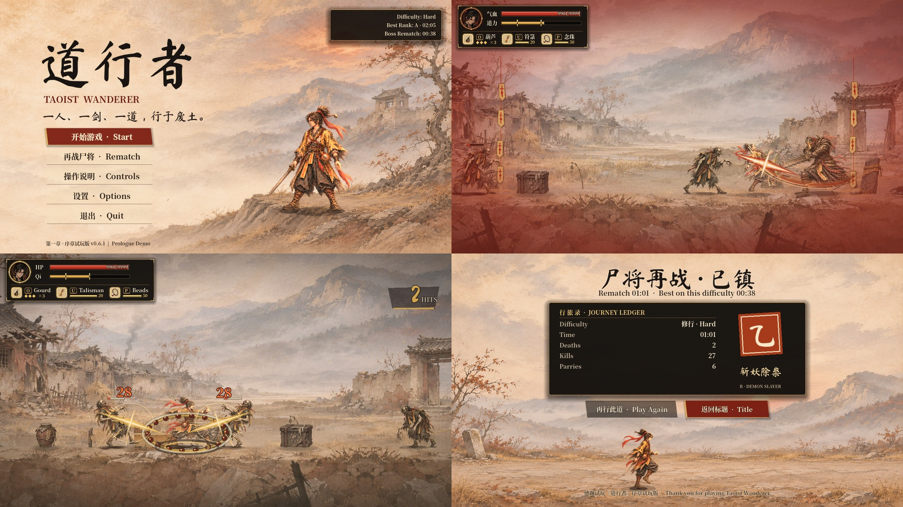

| 入口 | 说明 |
| --- | --- |
| **[下载 v0.6.1 预发布包（macOS / Windows / Linux）](https://github.com/lsaac1208/mtdm/releases/tag/v0.6.1)** | 内置试玩指南/已知问题/反馈表与 SHA-256 校验值；macOS 通用包已在 Apple Silicon 真机验证（`99/99 PASS`） |
| **[当前开发分支 `claude/autonomous-v05`](https://github.com/lsaac1208/mtdm/tree/claude/autonomous-v05)** | 完整 Godot 4.7.2 工程、美术/音频生成脚本与自动化测试（`99/99 PASS`） |
| **[英文交接总览 `HANDOFF.md`](https://github.com/lsaac1208/mtdm/blob/claude/autonomous-v05/HANDOFF.md)** · **[中文状态 `DEVELOPMENT_STATUS.md`](https://github.com/lsaac1208/mtdm/blob/claude/autonomous-v05/DEVELOPMENT_STATUS.md)** | 架构说明、渲染层级、已验证/待办清单与后续接手步骤 |
| **[运行构建 `BUILD_AND_RUN.md`](https://github.com/lsaac1208/mtdm/blob/claude/autonomous-v05/BUILD_AND_RUN.md)** · **[变更日志 `CHANGELOG.md`](https://github.com/lsaac1208/mtdm/blob/claude/autonomous-v05/CHANGELOG.md)** · **[路线图 `ROADMAP.md`](https://github.com/lsaac1208/mtdm/blob/claude/autonomous-v05/ROADMAP.md)** · **[架构决策 `DECISIONS.md`](https://github.com/lsaac1208/mtdm/blob/claude/autonomous-v05/DECISIONS.md)** | 本地跑测、导出打包与 D1–D44 设计取舍记录 |
| **[v0.6.1 实机截图、性能与原生验收报告](https://github.com/lsaac1208/mtdm/blob/claude/autonomous-v05/evidence/v0.6.1/README.md)** · **[试玩指南 `playtest/README.md`](https://github.com/lsaac1208/mtdm/blob/claude/autonomous-v05/playtest/README.md)** | Apple Silicon Metal 实机截屏、帧时与原生 `.app` 验收日志 |
| 历史里程碑回溯 | [v0.6.0](https://github.com/lsaac1208/mtdm/releases/tag/v0.6.0) · [v0.4.0](https://github.com/lsaac1208/mtdm/releases/tag/v0.4.0)（`codex/demo-v0.4.0`）· [v0.3.1](https://github.com/lsaac1208/mtdm/releases/tag/v0.3.1) · [v0.3.0-rc.1](https://github.com/lsaac1208/mtdm/releases/tag/v0.3.0-rc.1) · [v0.2.0](https://github.com/lsaac1208/mtdm/releases/tag/v0.2.0) |

```bash
# 开发人员快速拉取最新工程（main 分支保持轻量设计总库，游戏工程在 claude/autonomous-v05）
git clone https://github.com/lsaac1208/mtdm.git && cd mtdm
git switch claude/autonomous-v05
godot --headless --path game --import && godot --path game
```

下文保留 `main` 分支的原始核心设定与第一批设计交付物，供开发人员查阅角色、敌人与世界观的设计依据。


> **「末日废土之上，道法不灭，万物异变。」**  
> *In the wasteland, the Tao endures, all things rot and transform.*
>
> **「一人、一剑、一道，行于废土。以道御剑，以符镇邪，以心守世。」**  
> *One Man, One Sword, One Tao, Through the Wasteland.*

本仓库是 **2D 横版动作游戏《道行者 / Taoist Wanderer》** 的**第一批核心研发交付物料库（First-Batch Developer Handoff Repository）**。  
开发人员（策划、程序、2D 原画、骨骼/逐帧动画、关卡设计）可通过本仓库全面了解项目的**核心立意、世界观生态、视觉美术铁律、主角战斗体系、第一批可实装敌人（尸祟·亡秽系 01–05）完整规格**，以及下一阶段的资产量产标准。

---

## 目录导航（Documentation & Asset Index）

| 序号 | 文档 / 目录路径 | 面向职能 | 核心内容概述 |
| :---: | :--- | :--- | :--- |
| **00** | [`README.md`](./README.md)（本页） | 全员必读 | 核心想法、游戏支柱、10 张母版设定图全览、快速上手指南 |
| **01** | [`docs/01_WORLD_AND_ART_BIBLE.md`](./docs/01_WORLD_AND_ART_BIBLE.md) | 全员 / 美术 / 策划 | 世界观设定、粗黑水墨废土画风规范、`150px` 四级缩放可读性铁律、敌我色板隔离、六大敌人阵营生态与尸祟八阶谱系 |
| **02** | [`docs/02_PROTAGONIST_SPEC.md`](./docs/02_PROTAGONIST_SPEC.md) | 程序 / 动画 / 美术 | 主角「道行者」三视图、五大法器装备（道剑/阴阳葫芦/念珠/腰间符箓/八卦护符）拆解、13 组战斗姿态与招式表、10 组表情与 7 组半身情绪立绘规格 |
| **03** | [`docs/03_FIRST_WAVE_ENEMIES_SPEC.md`](./docs/03_FIRST_WAVE_ENEMIES_SPEC.md) | 程序 / 动画 / 策划 | 第一批可实装尸祟敌人（`01 普通尸祟`、`02 伏爬者`、`03 封印残尸`、`04 瘴吐者`）单体最终设定拆解、碰撞框/分件动画结构、抛物线投射物与前期遭遇编组（Group A–D） |
| **04** | [`docs/04_UNDEAD_WARRIOR_ELITE_SPEC_AND_REVISION.md`](./docs/04_UNDEAD_WARRIOR_ELITE_SPEC_AND_REVISION.md) | 美术 / 策划 / 程序 | `05 尸将·前期精英单位` 完整 27 节生产级规格书、V1.0 初稿评审诊断（8.8/10）与 V1.1 生产修正版 Prompt（强化「尸 > 甲」） |
| **05** | [`docs/05_DEVELOPER_HANDOFF_AND_ROADMAP.md`](./docs/05_DEVELOPER_HANDOFF_AND_ROADMAP.md) | 程序 / 动画 / 制作人 | 跨职能工程对接表、`1.8m = 150px` 物理与像素换算表、战斗状态机（FSM）、单体设定稿 11 模块工业标准与后续批次资产路线图 |
| **06** | [`concept_art/`](./concept_art/) + [`MANIFEST.json`](./concept_art/MANIFEST.json) | 美术 / 动画 / 程序 | 第一批 **10 张高清母版设定图（PNG）** 及结构化元数据清单 |
| **07** | [`raw_chat/conversation_complete.md`](./raw_chat/conversation_complete.md) | 核心主创参考 | 原始设计对话完整文字记录（一字未改）与 [`conversation_raw.json`](./raw_chat/conversation_raw.json) |

---

## 一、核心创意与设计支柱（Core Vision & Pillars）

### 1. 为什么做《道行者》？（题材与气质定位）
我们不是在做传统的「仙侠御剑修真」，也不是在做西式「中世纪黑暗奇幻或现代丧尸废土」，而是将 **「末日废土的苍凉残破感」** 与 **「东方道术的民俗仪式感」** 深度融合：
- **世界已经崩坏**：旧文明与道门圣地皆已沦为废墟，大地被「秽气」侵蚀，死者在失效的符咒与怨念纠缠下化为「尸祟」，邪修、畸变兽、废土暴徒、失控道门造物与古神遗迹守卫盘踞四方。
- **道心未灭**：主角「道行者」并非高高在上的神仙，而是身穿磨损风化的土黄道袍、背负残剑与旧葫芦、在废土泥泞中独行的旅人——**「末世行道，心向大道」**。
- **克制、冷峻、有重量感**：无论是美术笔触还是战斗手感，都追求**粗砺手绘墨线、沉实物理重量、克制而凌厉的道法特效**，拒绝浮夸光污染。

### 2. 横版动作战斗的四大设计铁律
1. **剪影优先（Silhouette-First Readability）**：
   2D 横版动作游戏的灵魂在于毫秒级态势读取。任何角色与怪物去掉内部细节涂成纯黑后，玩家必须凭外轮廓立刻认出**它是谁、面朝哪、正在待机还是蓄力重击**。
2. **高度与职能互补（Verticality & Role Synergy）**：
   第一批 5 个敌人绝不是换皮怪，而是围绕主角的招式库精准设计的「战斗考题」：
   - **普通尸祟（中段正面）** → 检验基础平砍与防扑反应；
   - **匍匐尸祟·伏爬者（极低段贴地）** → 躲避主角常规高段横斩，逼迫玩家使用**下劈 / 冲刺斩 / 低段技能**；
   - **封印残尸·残法衣尸祟（中近距高韧性+反制）** → 拥有 **「符力溃散」** 近身震爆，惩罚无脑贪刀；
   - **喷秽尸祟·瘴吐者（中远距抛物线+地形污染）** → 喉囊蓄力极醒目，抛射腐液弹并在地面留毒潭，逼迫玩家位移切后排；
   - **尸将·前期精英（重装压迫+大前摇重劈/横扫）** → 检验距离控制、闪避时机与破绽反击。
3. **150px 四级缩放可读性检验（4-Tier Scale QA）**：
   以主角身高 **`1.8m = 游戏内 150px`** 为绝对标尺，所有单位资产必须通过 **`150px (100%)` → `100px (75%)` → `75px (50%)` → `50px (33%)`** 四级缩略图检验，确保缩到最小时核心识别点（主角黄袍红穗、普通尸祟前倾扑姿、伏爬者贴地长臂、封印残尸覆面黄符、喷秽者鼓胀绿喉囊、尸将重刃残甲）依然一目了然。
4. **严格的敌我色彩隔离（Color Isolation）**：
   - **主角（道行者）**：独占高识别度的 **暖土黄道袍 (`#C69B4B`) + 炭黑内衬 (`#232122`) + 鲜明朱红绳穗 (`#9B2B23`) + 洁净符纸黄白 (`#D9BA73`)**。
   - **敌方（尸祟阵营）**：锁定 **死尸灰白 (`#C5BFB3`) + 尸毒灰绿 (`#6E786B`) + 瘴绿 (`#556B45`) + 污灰 (`#78756E`) + 枯褐 (`#634832`) + 暗血红 (`#7C231D`)**；敌方身上的红绳与黄符必须是**断裂、污损、低饱和、小面积（≤10%–15%）的失效残留物**，严禁抢占主角的视觉焦点。

---

## 二、第一批交付母版设定图全览（10 Sheets Master Gallery）

### 模块 A：主角「道行者 / Taoist Wanderer」设定体系（01–03）

#### 01. 《道行者·最终装备设定资料集 V2》(Final Equipment Specification Sheet V2)
- **文件**：[`concept_art/01_protagonist_equipment_v2.png`](./concept_art/01_protagonist_equipment_v2.png)（`1448 × 1086`）
- **核心内容**：完整定义主角五大随身法器与穿戴挂载关系——`01 道剑`（全装/出鞘/剑鞘 + 缠绳/太极护手/刀身云纹/剑鞘磨损）、`02 阴阳葫芦`、`03 念珠`、`04 腰间符箓`、`05 八卦护符`、三视图穿戴位置、腰部挂载详图、4 种法器使用状态参考与 7 色标准色卡。

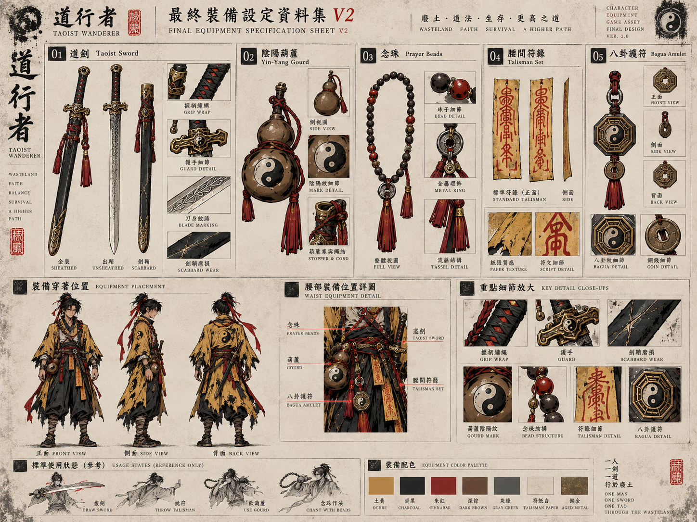

---

#### 02. 《道行者·战斗姿态设定稿 V1.0》(Combat Pose Design V1.0)
- **文件**：[`concept_art/02_protagonist_combat_poses_v1.png`](./concept_art/02_protagonist_combat_poses_v1.png)（`1536 × 1024`）
- **核心内容**：完整定义主角 **13 组核心横版战斗动作**（`01 战斗站姿`、`02 拔剑`、`03 横斩`、`04 下劈`、`05 突刺`、`06 冲刺斩`、`07 跳跃攻击`、`08 符箓攻击`、`09 阴阳葫芦`、`10 念珠施法（双阶段）`、`11 防御/格挡`、`12 受击`、`13 收势/落地`），并给出纯黑动作轮廓剪影、战斗神态、脚部重心/飘带/袖摆物理细节及四类法术特效轨迹。

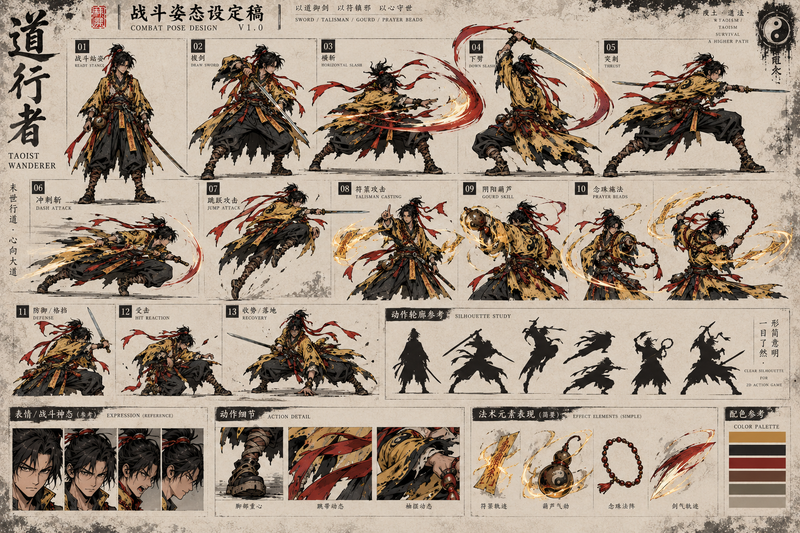

---

#### 03. 《道行者·角色表情与情绪设定资料集》(Character Expression & Mood Concept Sheet)
- **文件**：[`concept_art/03_protagonist_expressions_mood.png`](./concept_art/03_protagonist_expressions_mood.png)（`1448 × 1086`）
- **核心内容**：定义主角的叙事性格弧光与 UI/剧情演出资产——**10 组面部表情集**、眼部情绪与眉口型参考、**7 组上半身情绪状态立绘**（静观、调息、战后停歇、负伤前行、回忆、压抑怒意、坚定前行）以及 **6 组废土小剧情氛围切片**。

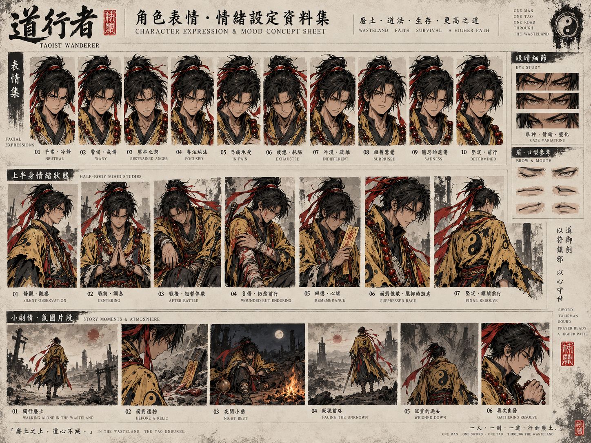

---

### 模块 B：世界观敌人生态与「尸祟·亡秽系」阵营总览（04–06）

#### 04. 《敌人生态·阵营/怪物/世界观体系设定》(Enemy Ecosystem Overview)
- **文件**：[`concept_art/04_enemy_ecosystem_overview.png`](./concept_art/04_enemy_ecosystem_overview.png)（`1536 × 1024`）
- **核心内容**：构建整个游戏的六大敌人阵营顶层架构——`01 尸祟·亡秽`、`02 邪修·堕道者`、`03 畸变兽·污染生物`、`04 废土人类势力`、`05 道门异化体`、`06 遗迹守御体`，包含各阵营 4 阶兵种、横版体型比例标尺（`1.8m` 主角至 `4m+` Boss）、阵营生态转化关系网与四大主要活动区域。

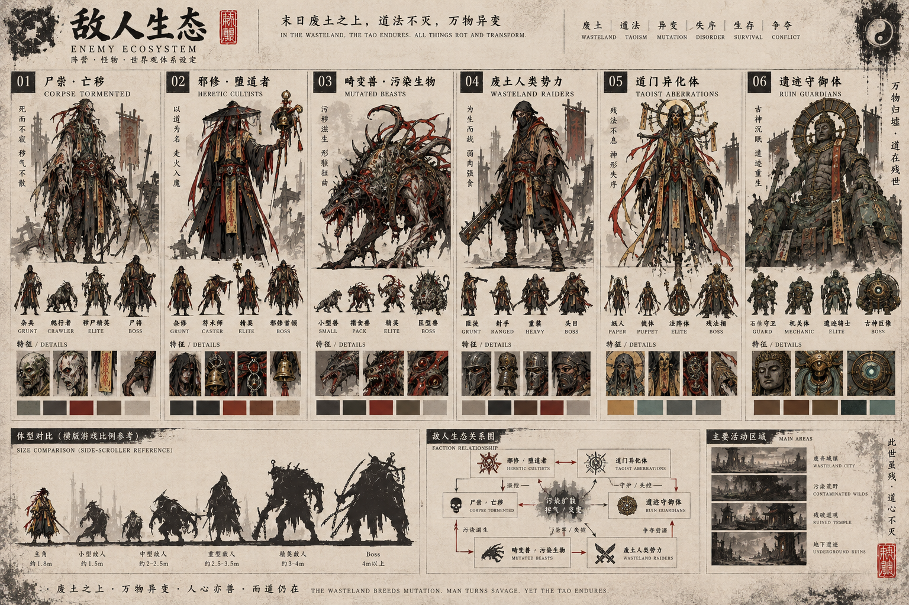

---

#### 05. 《尸祟/亡秽系·阵营总览详细设定》(The Undead Tainted — Faction Overview)
- **文件**：[`concept_art/05_corpse_tainted_faction_overview.png`](./concept_art/05_corpse_tainted_faction_overview.png)（`1672 × 941`）
- **核心内容**：深入展开第一主力阵营「尸祟·亡秽系」的 **8 阶完整进化谱系**（`01 普通尸祟` → `02 匍匐型` → `03 残法衣尸祟` → `04 喷秽体` → `05 尸将` → `06 重型亡秽体` → `07 小BOSS` → `08 BOSS 秽骨之王`）、五大阵营共性特征、头/手/躯干/符箓局部研究、8 阶剪影与体型对比、8 类关卡生态分布表及阵营材质色板。

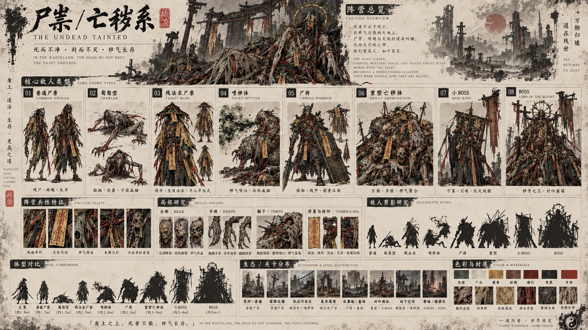

---

#### 06. 《尸祟阵营·第一批可实装敌人设定稿》(First-Wave Production Enemy Sheet)
- **文件**：[`concept_art/06_corpse_tainted_first_wave_sheet.png`](./concept_art/06_corpse_tainted_first_wave_sheet.png)（`1536 × 1024`）
- **核心内容**：锁定前期关卡直接投入制作的第一批 **5 类可实装尸祟单位**（`01 普通尸祟`、`02 伏爬者`、`03 封印残尸`、`04 瘴吐者`、`05 尸将`），对比五者与主角的横版体型与剪影，并明确定义 **前期遭遇战标准编组（Group A / B / C / D）**。

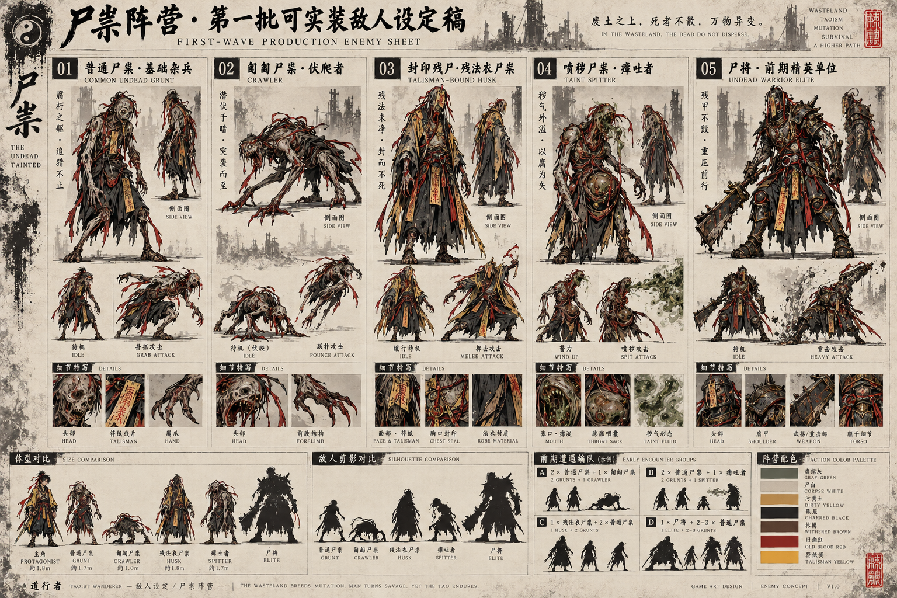

---

### 模块 C：第一批可实装敌人单体最终设定稿（07–10，工业化生产母版）

#### 07. 《01 普通尸祟·基础杂兵 单体最终设定稿》(Common Undead Grunt — Final Model Sheet V1.0)
- **文件**：[`concept_art/07_common_undead_grunt_sheet.png`](./concept_art/07_common_undead_grunt_sheet.png)（`1672 × 941`）
- **核心内容**：基础近战杂兵（身高 `1.5–1.6m`），含最终形象、三视图、横版战斗侧视图、体型对比、4 组关键动作（徘徊、警觉、扑击前奏、撕咬攻击）、剪影研究、5 项局部特写与 `150px→50px` 四级可读性检查。

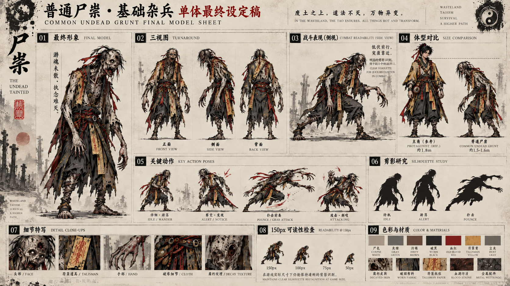

---

#### 08. 《02 匍匐尸祟·伏爬者 单体最终设定稿》(Crawler — Final Enemy Model Sheet V1.0)
- **文件**：[`concept_art/08_crawler_sheet.png`](./concept_art/08_crawler_sheet.png)（`1536 × 1024`）
- **核心内容**：贴地高速突袭单位（体长 `0.8–1.0m`），除标准三视图与 6 组基础动作（待机、警觉、快速爬行、突扑攻击、受击、回撤）外，专门提供 **`09 攻击判定框（红）与低矮受击框（蓝）工程示意`** 以及 **`10 供骨骼动画使用的 10 部件结构拆分图`**。

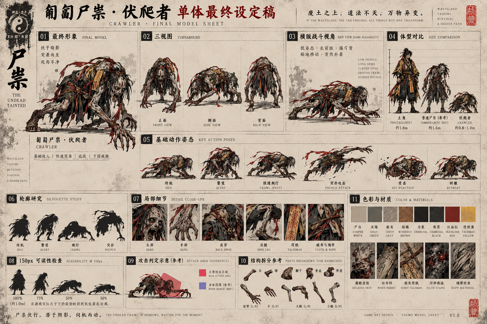

---

#### 09. 《03 封印残尸·残法衣尸祟 单体最终设定稿》(Talisman-Bound Husk — Final Enemy Model Sheet V1.0)
- **文件**：[`concept_art/09_talisman_bound_husk_sheet.png`](./concept_art/09_talisman_bound_husk_sheet.png)（`1448 × 1086`）
- **核心内容**：中坚压迫与近身反制单位（身高 `约1.7m`），符纸覆面、身披残破道门法衣，含 7 组关键动作姿态（待机·封印之静、苏醒·封印崩裂、缓步前行、挥袖攻击、**符力溃散（近身爆发反制）**、受击、崩塌·再度沉寂）与 6 项封印细节特写。

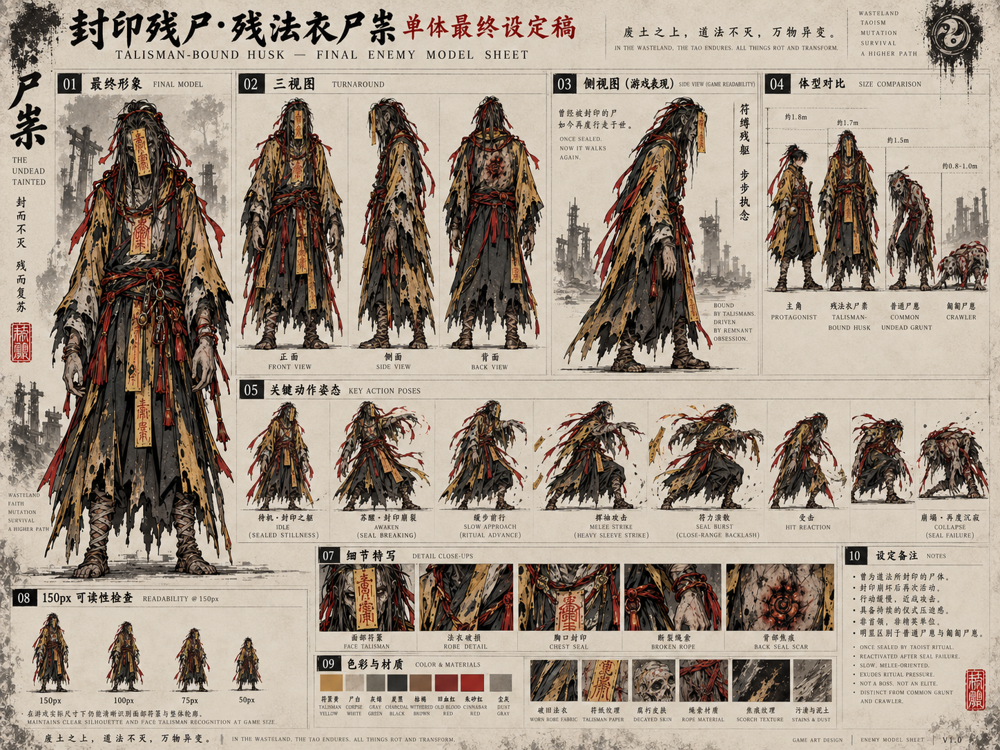

---

#### 10. 《04 喷秽尸祟·瘴吐者 单体最终设定稿》(Taint Spitter — Final Enemy Model Sheet V1.0)
- **文件**：[`concept_art/10_taint_spitter_sheet.png`](./concept_art/10_taint_spitter_sheet.png)（`1536 × 1024`）
- **核心内容**：前期核心远程骚扰与地形封锁单位（身高 `1.6–1.7m`），以膨胀发光的黄绿「喉囊 (Throat Sac)」为第一视觉焦点，含 8 组关键动作姿态（待机、警觉、蓄力膨胀、喷吐攻击、恢复、近身挥击、受击、死亡崩解）及 **`06 投射物三阶段（喷出/飞行/爆裂）与侧面抛物线弹道设定`**。

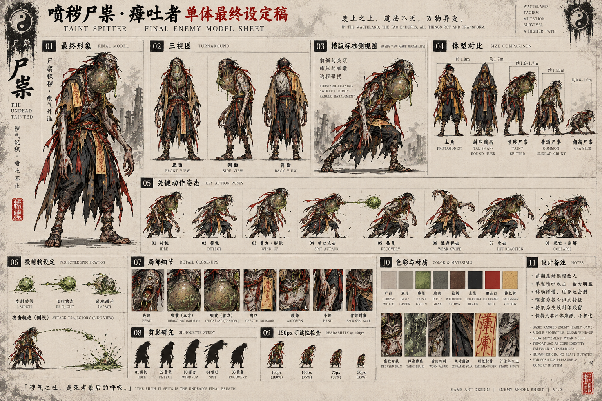

---

## 三、第 5 个可实装单位《05 尸将·前期精英单位》当前进度与交接说明

在第一批 5 个可实装敌人中：
- `01 普通尸祟`、`02 伏爬者`、`03 封印残尸`、`04 瘴吐者` 的单体最终设定稿已定稿（即上方图 `07`–`10`）。
- 第 5 个单位 **`05 尸将·前期精英单位 (Undead Warrior Elite)`** 已完成：
  1. 在 [`06_corpse_tainted_first_wave_sheet.png`](./concept_art/06_corpse_tainted_first_wave_sheet.png) 右一列确立了基础视觉方向与 `组合 D` 遭遇战定位；
  2. 完成了 **27 节完整生产级设定规格书**；
  3. 完成了对 V1.0 初版生成稿的 **8.8/10 评审诊断**，明确了 V1.1 的 **五大收束修正方向**（退半步避免小 Boss 化、装甲覆盖率降低 15%–20% 强化左甲右露的非对称残损、头部改为半边残护面暴露死白腐脸以确立 **「尸 > 甲」**、重刃缩小 10%–15%、红色碎布减少 20%–30%）。
- 完整规格书、评审意见与可直接复制生图的 V1.1 Prompt 已全部整理在 👉 **[`docs/04_UNDEAD_WARRIOR_ELITE_SPEC_AND_REVISION.md`](./docs/04_UNDEAD_WARRIOR_ELITE_SPEC_AND_REVISION.md)**。

---

## 四、开发团队快速阅读路径建议

1. **所有新加入成员**：先浏览本页 `README.md` 的 10 张设定图，建立对「末日废土 + 东方道术」视觉调性与横版比例的直观认知。
2. **主美 / 原画 / 动画师**：重点阅读 [`docs/01_WORLD_AND_ART_BIBLE.md`](./docs/01_WORLD_AND_ART_BIBLE.md) 与 [`docs/04_UNDEAD_WARRIOR_ELITE_SPEC_AND_REVISION.md`](./docs/04_UNDEAD_WARRIOR_ELITE_SPEC_AND_REVISION.md)，严格遵循 `150px` 四级可读性标准、敌我色板隔离法则与 11 模块单体设定板式。
3. **程序 / 战斗策划 / 关卡策划**：重点阅读 [`docs/02_PROTAGONIST_SPEC.md`](./docs/02_PROTAGONIST_SPEC.md)、[`docs/03_FIRST_WAVE_ENEMIES_SPEC.md`](./docs/03_FIRST_WAVE_ENEMIES_SPEC.md) 与 [`docs/05_DEVELOPER_HANDOFF_AND_ROADMAP.md`](./docs/05_DEVELOPER_HANDOFF_AND_ROADMAP.md)，按规格实现主角 13 招式状态机、5 类敌人的碰撞框/AI 行为树及前期 A/B/C/D 四类遭遇战编组。
