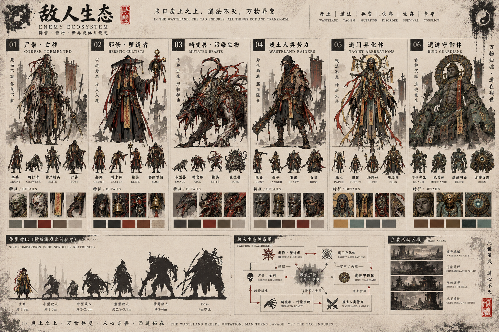
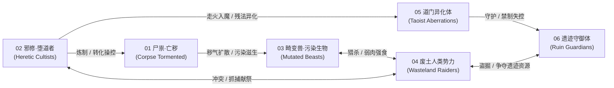
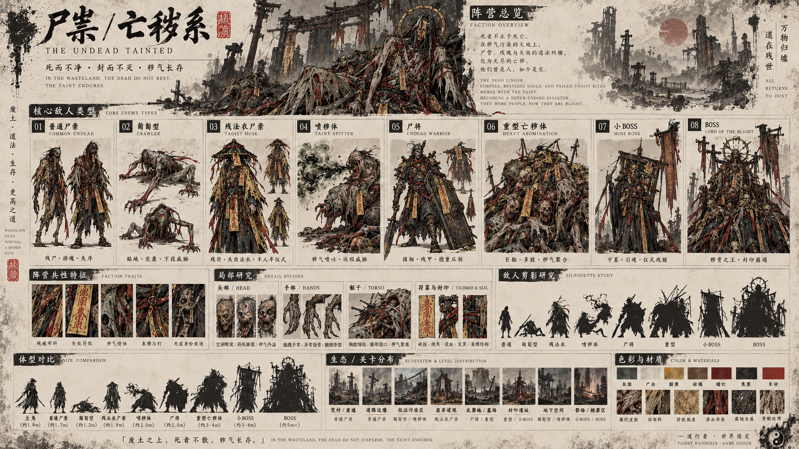

# 《道行者 / Taoist Wanderer》世界观、美术风格与敌人生态圣经 (Worldbuilding, Art Bible & Enemy Ecosystem)

> **核心母题**：「末日废土之上，道法不灭，万物异变。」  
> *In the wasteland, the Tao endures, all things rot and transform.*
>
> **生态母题**：「废土之上，万物异变，人心亦兽，而道仍在。」  
> *The wasteland breeds mutation, man turns savage, yet the Tao endures.*

本文档面向 **全员（策划、原画、动画、程序、关卡设计）**，定义《道行者 / Taoist Wanderer》的世界观架构、视觉美术生产规范、敌我色彩与可读性铁律、六大敌人阵营顶层生态，以及第一主力阵营「尸祟·亡秽系」的八阶完整谱系。

---

## 一、项目核心定位与精神内核

### 1.1 基本信息
- **项目名称**：《道行者 / Taoist Wanderer》（开发代号：`mtdm`）
- **核心类型**：2D 横版动作游戏（2D Side-Scrolling Action Game）
- **题材融合**：**末日废土（Post-Apocalyptic Wasteland） + 东方道术（Eastern Taoist Sorcery）**
- **核心关键词**：`废土 (Wasteland)` · `道法 (Taoism)` · `异变 (Mutation)` · `失序 (Disorder)` · `生存 (Survival)` · `争夺 (Conflict)` · `更高之道 (A Higher Path)`

### 1.2 世界观基底：何为「末日废土 + 东方道术」？
本项目的核心审美与叙事建立在**双重秩序崩塌后的残存感**之上：
1. **不是传统仙侠，而是「泥泞与血锈中的残存道统」**：
   道门不再是云端仙山，而是坍塌的道观、断折的石碑、褪色撕裂的黄符、缠满血垢红绳的旧法器。道术不是华丽的彩虹光炮，而是带着朱砂、墨迹、火焦与铜铁质感的镇邪之术。
2. **不是西式丧尸或哥特亡灵，而是「秽气与失效封印纠缠的东方尸祟」**：
   大灾变后，「秽气（Taint / Miasma）」浸染大地。死者不仅肉身腐败，还与生前执念、破损法衣、松动的朱砂镇符、镇尸铁钉纠缠在一起，形成具有鲜明东方民俗恐怖感与废土生存压迫感的「尸祟（The Undead Tainted）」。
3. **主角「道行者」的孤独旅途**：
   「一人、一剑、一道，行于废土。」主角身着风化破损的土黄道袍，腰悬阴阳葫芦、八卦护符与符箓，手持道剑与念珠，在荒村、污染荒野、残破道观与地下古神遗迹中穿行，斩除邪祟、镇压异变、探寻废土背后的大道。

---

## 二、视觉美术总规范（Art Direction & Production Rules）

### 2.1 画面风格四要素
1. **粗黑手绘水墨勾线（Thick Hand-Drawn Ink Linework）**：
   - 外轮廓采用粗砺、有顿挫感与笔锋变化的浓墨黑线，强化角色与怪物的体量感与剪影边界；
   - 内部衣褶、腐肉纹理、护甲裂痕采用中细排线与飞白皴擦，体现废土粗粝感。
2. **分层赛璐璐色块 + 宣纸做旧底纹（Layered Cel Shading & Aged Parchment Texture）**：
   - 固有色块控制在 2–3 层明暗转折，不搞过度油腻的写实厚涂或模糊渐变，确保转化为 2D 动画帧或骨骼分件时结构绝对稳定。
3. **废土风化与磨损细节（Wasteland Weathering）**：
   - 所有服饰下摆、武器剑鞘、符纸边缘必须带有**撕裂缺口、泥浆溅射、火焦黑边、陈旧血渍或铜绿铁锈**，严禁出现全新光洁的布料或金属。
4. **东方道门符号语言的克制运用**：
   - 核心符号包括：**太极阴阳鱼、八卦盘、朱砂敕令黄符、古铜钱（方孔圆钱）、朱红编绳与流苏、黑木与朱砂念珠、道剑云雷纹**。

### 2.2 横版动作游戏第一铁律：剪影优先与四级缩放可读性（150px Baseline）

在 2D 横版动作游戏中，玩家注意力高度集中在角色周围 3–6 米的战斗区域。所有角色与怪物设计必须通过 **四级缩放可读性检查（Readability Check）**：

| 缩放层级 | 像素高度基准（以主角 1.8m 为准） | 对应游戏视距场景 | 强制验收标准 |
| :---: | :---: | :--- | :--- |
| **Tier 1 (100%)** | **`150 px`** | 标准横版战斗镜头 | 主体结构、武器形态、面朝方向、核心特征（如道剑、覆面符、鼓胀喉囊、左肩残甲）清晰锐利 |
| **Tier 2 (75%)** | **`100 px`** | 相机拉远 / 多怪同屏混战 | 三级细碎裂纹自然收敛，大色块分割（如土黄道袍 vs 尸白腐肉）、四肢动作开合依然一清二楚 |
| **Tier 3 (50%)** | **`75 px`** | 远景平台 / 大型 Boss 战远镜头 | 仅凭身体倾斜角、剪影外廓与第一视觉焦点色块，即可在 0.2 秒内读出敌人种类与攻击前摇 |
| **Tier 4 (33%)** | **`50 px`** | 极限缩略图检验 / 最小可读阈值 | 不糊成一团黑影；高矮胖瘦与姿态动势（站立/匍匐/前倾/举刀）依旧可辨 |

### 2.3 主角色板 vs 尸祟阵营色板（敌我视觉隔离铁律）

为防止在高速混战、暗光废墟或特效叠加时发生「敌我不分」，**主角与尸祟阵营实行严格的色相与饱和度隔离**：

#### A. 主角「道行者」标准 7 色板（高识别暖黄 + 鲜明朱红）
| 色名（中/英） | HEX 参考值 | 材质与应用部位 | 视觉权重 |
| :--- | :---: | :--- | :--- |
| **土黄 / Ochre** | `#C69B4B` | 外层道袍主色（做旧粗麻布，下摆泥渍磨损） | 主色调（约 40%） |
| **炭黑 / Charcoal** | `#232122` | 内衬劲装、束腿裤、长发、剑鞘底色、重墨勾线 | 骨架色（约 30%） |
| **朱红 / Cinnabar** | `#9B2B23` | 发带、剑穗、葫芦流苏、念珠隔珠、腰带绳结（动态视觉引导） | 焦点色（约 12%） |
| **深棕 / Dark Brown** | `#4A3326` | 阴阳葫芦本体、皮革护腕、腰封、靴面 | 材质色（约 8%） |
| **灰绿 / Gray-Green** | `#6F786D` | 内层护具衬布、旧化阴影冷灰过渡 | 辅助色（约 4%） |
| **符纸白 / Talisman Paper** | `#D9BA73` | 腰间标准符箓、道袍内衬浅边、太极阳面 | 提亮色（约 3%） |
| **铜金 / Aged Metal** | `#7B6D54` | 道剑太极护手、剑首、八卦护符、古铜钱环饰 | 点缀色（约 3%） |

#### B. 尸祟·亡秽系标准 9 色板（冷灰死白 + 尸毒腐绿 + 暗沉血锈）
| 色名（中/英） | HEX 参考值 | 材质与应用部位 | 视觉约束规则 |
| :--- | :---: | :--- | :--- |
| **尸白 / Corpse White** | `#C5BFB3` | 腐败死尸皮肤、干枯骨骼、死白面部 | 严禁做成干净亮白，必须带冷灰尸斑 |
| **灰绿 / Gray-Green** | `#6E786B` | 尸毒侵蚀肌肉、霉变布料、腐烂阴影 | 尸祟阵营标志性冷色调 |
| **瘴绿 / Taint Green** | `#556B45` | 喷秽者鼓胀喉囊、腐液投射物、秽气泄漏处 | 远程/毒秽危险提示色 |
| **污灰 / Dirty Gray** | `#78756E` | 破烂裹尸布、废土泥灰、风化麻布 | 大面积中性过渡色 |
| **枯褐 / Withered Brown** | `#634832` | 干涸腐肉、烂木枷、旧麻绳、陈年污垢 | 结构暗部与泥土感 |
| **炭黑 / Charcoal Black** | `#1F1D1E` | 残破法衣底色、重残甲、焦痕、空洞眼窝 | 强化压迫感与轮廓 |
| **暗血红 / Old Blood Red** | `#7C231D` | 干涸血污、断裂封绳、残符褪色朱砂 | **严禁使用高饱和鲜红**，占比 ≤ 10%–15% |
| **锈铁红 / Rusted Iron Red** | `#5E2A22` | 镇尸铁钉、尸将残甲锈斑、重砍刀血锈 | 金属腐朽质感 |
| **符纸黄 / Talisman Yellow** | `#C9A449` | 失效破损的镇尸黄符（必须带焦边、污渍、裂口） | 仅作局部叙事点缀，不可抢主角土黄主色 |

---

## 三、六大敌人阵营生态总设定（对应图 04）

游戏世界由 **六大核心敌人阵营** 构成完整的废土生态链，涵盖从底层感染死者、堕落修道者、野外异变生物、人类掠夺者，到失控道门造物与远古遗迹守卫：

### 3.1 六大阵营全览表

| 编号 | 阵营名称（中 / 英） | 阵营母题口号 | 4 阶兵种构成（从左至右） | 核心视觉与材质特征 | 战斗与玩法定位 |
| :---: | :--- | :--- | :--- | :--- | :--- |
| **01** | **尸祟·亡秽** `Corpse Tormented` | *死而不散，秽气不歇* | `杂兵 Grunt` `爬行者 Crawler` `秽尸精英 Elite` `尸将 Boss` | 死白腐肉、破烂麻布、失效黄符、断裂红绳、镇尸铁钉 | **第一主力基础阵营**：数量最多、分布最广，承担前中期核心横版战斗教学与压迫 |
| **02** | **邪修·堕道者** `Heretic Cultists` | *以道为名，走火入魔* | `恶修 Grunt` `符咒师 Caster` `精英 Elite` `邪修首领 Boss` | 黑红邪道袍、血画邪符、诡异高冠/骨面、铜铃骨杖、肉身异化 | **中远距法术与控场阵营**：驱使尸祟、施放邪符咒法、布设血阵与召唤 |
| **03** | **畸变兽·污染生物** `Mutated Beasts` | *污秽滋生，形骸扭曲* | `小型兽 Small` `群居兽 Pack` `精英 Elite` `巨型兽 Boss` | 扭曲兽躯、外露白骨脊椎、多眼/骨刺、腐肉脓包、利爪獠牙 | **高机动野性冲锋阵营**：不规则运动轨迹、高速扑咬、群体围猎、大型狂暴兽战 |
| **04** | **废土人类势力** `Wasteland Raiders` | *为生而狂，弱肉强食* | `暴徒 Grunt` `射手 Ranged` `重装 Heavy` `头目 Boss` | 废铁拼凑护甲、防毒面罩/斗笠、改装弩机/火铳、带刺重锤/锯刃 | **战术配合与器械阵营**：近战盾卫+后排冷热兵器射击+投掷物，具备人类战术协同 |
| **05** | **道门异化体** `Taoist Aberrations` | *残法不息，神形失序* | `纸人 Paper` `傀儡 Puppet` `法阵体 Elite` `残法体 Boss` | 惨白朱砂纸人、机关木偶关节、破碎八卦轮盘、失控符阵与铜钱剑 | **诡谲机制与规则杀阵营**：伪装突袭、分裂再生、八卦机关阵与飞剑弹幕 |
| **06** | **遗迹守御体** `Ruin Guardians` | *古神沉眠，遗迹不死* | `石像守卫 Guard` `机关体 Mechanic` `遗迹骑士 Elite` `古神巨像 Boss` | 风化青铜与巨石雕刻、古神兽面纹、内部符文齿轮、巨型石质/青铜重兵 | **高防重型守关阵营**：极高霸体与防御、规律性大范围机械/神力扫荡、弱点破坏机制 |

### 3.2 六大阵营生态关系网（Faction Ecological Relationships）

### 3.3 横版体型梯度与四大主要活动区域
- **横版体型梯度标准（Size Comparison）**：
  - **主角（道行者）**：`约 1.8m`（`150px` 基准）
  - **小型敌人（匍匐尸祟、小型畸变兽、纸人）**：`约 0.8m–1.5m`
  - **中型敌人（普通尸祟、恶修、暴徒、封印残尸、喷秽者）**：`约 1.6m–2.5m`
  - **重型敌人（重装暴徒、尸将、重型亡秽体、机关体）**：`约 2.2m–3.5m`
  - **精英敌人（秽尸精英、法阵体、遗迹骑士）**：`约 3.0m–4.0m`
  - **Boss 级单位（秽骨之王、古神巨像、巨型畸变兽）**：`4.0m 以上（4.5m–5m+）`
- **四大主要活动区域（Main Areas）**：
  1. **废弃城镇 (Wasteland City)**：断壁残垣、坍塌街巷，主要分布「普通尸祟、匍匐尸祟、废土人类势力」。
  2. **污染荒野 (Contaminated Wilds)**：枯林、毒沼、乱葬岗，主要分布「尸祟群、喷秽者、畸变兽·污染生物」。
  3. **残破道观 (Ruined Temple)**：倾颓殿宇、碎裂神像、失控符阵，主要分布「封印残尸、尸将、邪修·堕道者、道门异化体」。
  4. **地下遗迹 (Underground Ruins)**：深层地宫、古神祭坛、秽源核心，主要分布「重型亡秽体、遗迹守御体、小 Boss 与 Boss 秽骨之王」。

---

## 四、第一主力阵营：「尸祟·亡秽系」八阶完整谱系（对应图 05）

> **阵营总览引言**：  
> *「死而不净，封而不灭，秽气长存。」*  
> *「死者不止于死亡。在秽气污染的大地上，尸骨、残魂与失效的道法纠缠，化为无尽的亡秽。他们曾是人，如今是灾。」*

### 4.1 尸祟系八大核心敌人层级表（01–08）

| 阶级 | 单位名称（中 / 英） | 体型高度 | 视觉特征关键词 | 战斗职能定位 | 当前资产状态 |
| :---: | :--- | :---: | :--- | :--- | :--- |
| **01** | **普通尸祟** `Common Undead` | `约 1.7m` （佝偻约 `1.55m`） | 残斗、游荡、失序；死白干瘪、肩背残符 | 基础近战杂兵（徘徊、前扑、撕咬） | ✅ 已有单体最终设定稿（图 07） |
| **02** | **匍匐型·伏爬者** `Crawler` | `约 0.8–1.2m` （贴地高度极低） | 贴地、突袭、下段威胁；长前肢、弓背露骨 | 高速贴地突袭（躲上段斩击、扑咬回撤） | ✅ 已有单体最终设定稿（图 08） |
| **03** | **残法衣尸祟·封印残尸** `Taoist Husk` | `约 1.7–1.8m` | 残符、失效道衣、半人半仪式；符纸覆面 | 中坚压迫近战 + 近身「符力溃散」爆发反制 | ✅ 已有单体最终设定稿（图 09） |
| **04** | **喷秽体·瘴吐者** `Taint Spitter` | `约 1.65–1.9m` | 秽气喷吐、远程威胁；鼓胀黄绿喉囊、前倾 | 中远距抛物线腐液喷射 + 地面毒潭封路 | ✅ 已有单体最终设定稿（图 10） |
| **05** | **尸将·前期精英** `Undead Warrior` | `约 2.0–2.2m` | 强敌、残甲、重兵压制；左肩残甲、厚背重刃 | 前期守关精英（高韧性、大前摇竖劈与横扫） | 🔄 已有总表形象（图 06）+ 27 节完整规格书 + V1.1 修正 Prompt |
| **06** | **重型亡秽体** `Heavy Abomination` | `约 2.8m` | 巨躯、多肢、秽气聚合；多具尸骸与铁枷融合 | 中后期重型肉盾/狂暴冲撞单位 | 📋 已在阵营总表（图 05）锁定概念与剪影 |
| **07** | **小BOSS（守墓/巨魂/仪式残骸）** `Mini Boss` | `约 3.4m` | 守墓、巨魂、仪式残骸；背负断碑/镇魂锁链 | 区域守关小 Boss（多阶段重型仪式攻击） | 📋 已在阵营总表（图 05）锁定概念与剪影 |
| **08** | **BOSS·秽骨之王** `Lord of the Blight` | `约 4.5m–5m+` | 秽骨之王、封印崩塌；巨型骨冠、万符缠身 | 章节大 Boss（大型场地压制、多阶段召唤与秽气爆发） | 📋 已在阵营总表（图 05）锁定概念与剪影 |

### 4.2 尸祟阵营五大共性特征与四大局部规范
- **五大阵营共性特征（Faction Traits）**：
  1. **残破布料**：腐烂麻布、撕裂旧道袍、泥泞裹尸布条，动态随动作拖拽下垂。
  2. **失效符箓**：焦边、撕裂、字迹洇开的黄符，证明「曾经被封印但封印已破」。
  3. **秽气侵蚀**：体表黑紫尸斑、灰绿霉斑、黄绿腐液结晶。
  4. **束缚与钉**：断裂朱红法绳、生锈锁链、钉入肩胛或脊椎的镇尸铁钉。
  5. **死白腐败肌理**：干瘪贴骨的肌肉线条、局部裸露的肋骨与脊椎骨节。
- **四大局部研究标准（Detail Studies）**：
  - **头部 (Head)**：空洞黑眼窝 / 符纸覆面 / 下颌脱臼撕裂 / 腐烂面容。
  - **手部 (Hands)**：枯瘦骨爪 / 淤黑指尖 / 缠绕断绳与符纸碎片。
  - **躯干 (Torso)**：胸腔塌陷露肋 / 腹部腐烂或膨胀 / 背部旧封印灼痕。
  - **符箓与封印 (Talisman & Seal)**：破损、暗淡、浸血、边缘卷曲的失效道符。

### 4.3 尸祟生态与关卡分布矩阵（Ecosystem & Level Distribution）

| 关卡区域类型 | 推荐分布的尸祟单位组合 | 环境氛围与战斗体验定位 |
| :--- | :--- | :--- |
| **01 荒村 / 废墟** | `普通尸祟` | 新手引导区：开阔平地，熟悉基础挥剑、闪避与距离控制 |
| **02 道路边缘** | `普通尸祟` + `匍匐型` | 引入高低段位差：伏爬者从草丛/残垣下突袭，训练下劈与低段应对 |
| **03 低洼污染区** | `匍匐型` + `喷秽体` | 地形限制区：毒水洼地配合后排瘴吐者抛射，训练位移切后排 |
| **04 废弃道观** | `残法衣尸祟` + `普通尸祟` | 道门叙事区：静立如尸桩的封印残尸突然苏醒，训练防「符力溃散」反制 |
| **05 墓地 / 乱葬岗** | `普通尸祟` + `匍匐型` + `尸将` | 前期高压测试区：多波次混合编组 + 第一个重装精英「尸将」守关 |
| **06 封印遗迹** | `残法衣尸祟` + `尸将` + `重型亡秽体` | 中期进阶区：高韧性敌群组合，考验符箓、葫芦与念珠技能协同 |
| **07 地下空间** | `重型亡秽体` + `小BOSS` | 幽闭压迫区：大型多肢亡秽体与守墓小 Boss 镇守通道 |
| **08 祭坛 / 秽源区** | `BOSS·秽骨之王` | 章节终局 Boss 战：封印彻底崩塌的核心祭坛 |
