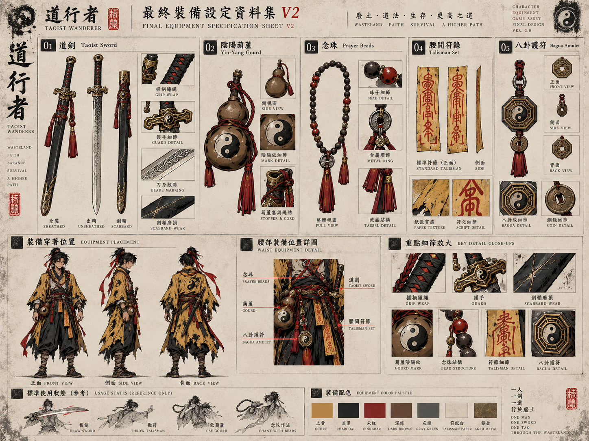
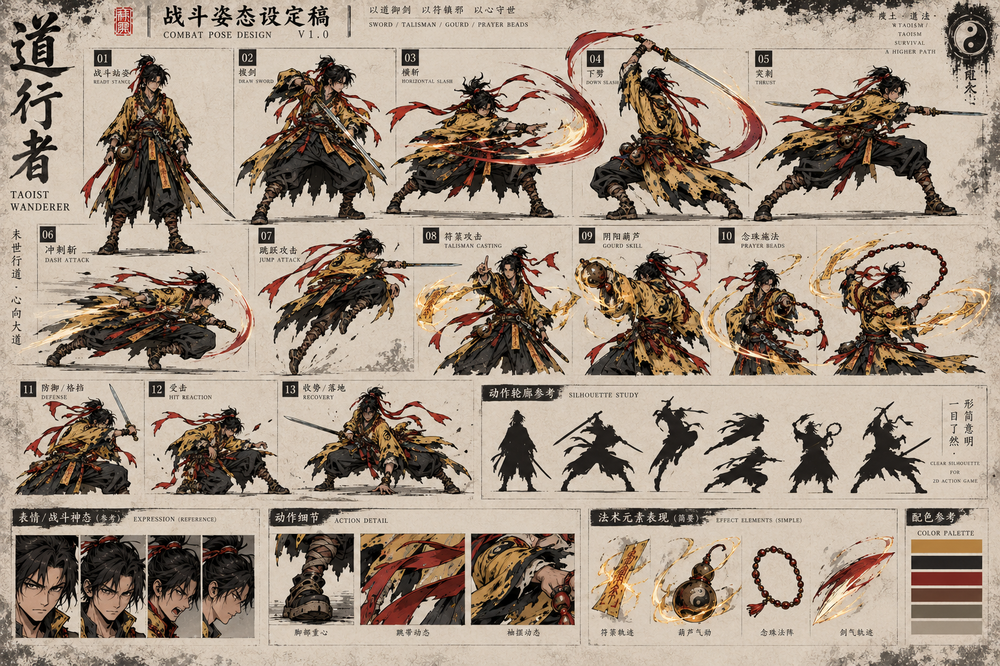
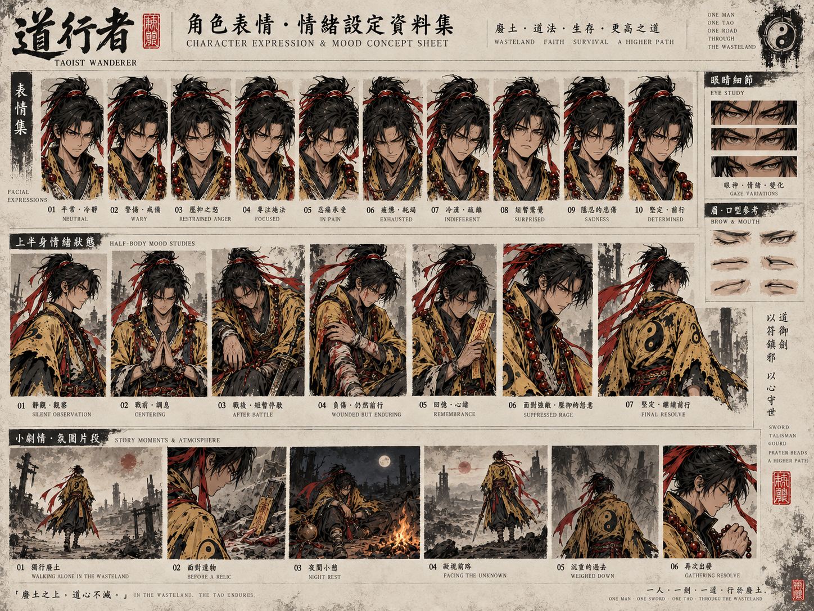

# 主角「道行者 / Taoist Wanderer」角色、法器装备、战斗动作与情绪表现规格书

> **角色信条**：「一人、一剑、一道，行于废土。」  
> *One Man, One Sword, One Tao, Through the Wasteland.*
>
> **战斗总纲**：「以道御剑 · 以符镇邪 · 以心守世」  
> *Sword · Talisman · Gourd · Prayer Beads*

本文档完整拆解主角 **「道行者 (Taoist Wanderer)」** 的三张生产母版设定稿（[`01_protagonist_equipment_v2.png`](../concept_art/01_protagonist_equipment_v2.png)、[`02_protagonist_combat_poses_v1.png`](../concept_art/02_protagonist_combat_poses_v1.png)、[`03_protagonist_expressions_mood.png`](../concept_art/03_protagonist_expressions_mood.png)），供程序、2D 动画师、特效师与 UI/叙事设计师直接对接实装。

---

## 一、角色基础规格与外观三视图拆解

### 1.1 基础体型与视觉标尺
- **标准身高**：`1.80m`（游戏内标准像素高度基准：**`150 px`**）
- **体态特征**：修长矫健、重心沉稳；高束黑发配长朱红发带（在横版高速移动、跳跃、闪避时提供清晰的运动残影与视觉引导）。
- **服饰层次（由内至外）**：
  1. **内层**：炭黑劲装短打 + 束腿长裤 + 绑腿护踝（确保下肢踢踏、冲刺、跳跃动作干净利落，不拖泥带水）；
  2. **中层**：土黄色宽袖道袍外褂（胸背印有做旧太极阴阳鱼纹，衣摆与袖口做撕裂、焦痕与废土泥渍磨损处理）；
  3. **外挂法器层**：颈挂黑曜朱砂念珠，腰间通过多层编织绳结与皮质腰封集中挂载「道剑、阴阳葫芦、腰间符箓、八卦护符」。

### 1.2 腰部与全身法器穿戴位置拓扑（Equipment Placement）

| 挂载部位 | 装备名称 | 穿戴方式与朝向（以角色自身左右为准） | 动态物理表现要求 |
| :--- | :--- | :--- | :--- |
| **颈部 / 胸前** | **03 念珠 (Prayer Beads)** | 环绕颈肩垂于胸前，战斗施法时可摘下盘绕于手臂或悬浮成阵 | 随呼吸与步伐小幅晃动，施法时流苏飘起 |
| **左腰侧后** | **01 道剑 (Taoist Sword)** | 斜挂于左侧腰际，剑柄朝前上方、剑鞘斜向后下方，配双股朱红长剑穗 | 拔剑/收剑轨迹顺畅；奔跑与急停时剑鞘微摆、剑穗滞后飘动 |
| **右腰前侧** | **02 阴阳葫芦 (Yin-Yang Gourd)** | 悬系于右侧腰带前部，正面朝外展示太极阴阳烙纹，底部垂双股红流苏 | 移动时有沉甸甸的摆动感 |
| **腰带正中偏右** | **05 八卦护符 (Bagua Amulet)** | 红绳悬垂于腰封前侧，下坠古铜钱与短红穗 | 随转身与跳跃轻摆 |
| **右腰侧后 / 前襟** | **04 腰间符箓 (Talisman Set)** | 多张标准黄符成叠夹挂于右侧腰封下沿，便于右手闪电抽符抛掷 | 纸张随疾风与冲刺微幅翻飞 |

---

## 二、五大核心法器与装备拆解（对应图 01 V2）

### 2.1 五大装备组件规格详表

| 编号 | 法器名称（中 / 英） | 子视图与结构拆解 | 核心局部特写（Key Close-ups） | 战斗功能映射 |
| :---: | :--- | :--- | :--- | :--- |
| **01** | **道剑** `Taoist Sword` | - `全装 (Sheathed)` - `出鞘 (Unsheathed)` - `剑鞘 (Scabbard)` | 1. **握柄缠绳 (Grip Wrap)**：黑底红线菱形交错缠法，防滑耐磨 2. **护手细节 (Guard Detail)**：古铜雕花一字护格，中心镶嵌太极阴阳鱼 3. **刀身纹路 (Blade Marking)**：直刃剑身蚀刻古道门云雷镇邪铭文 4. **剑鞘磨损 (Scabbard Wear)**：乌木黑鞘包铜口与铜镖，表面布满十字刀痕与掉漆 | **主力近战武器**：承担普攻连段（拔剑、横斩、下劈、突刺）、冲刺斩、跳劈与格挡弹反 |
| **02** | **阴阳葫芦** `Yin-Yang Gourd` | - `正面主视图` - `侧视图 (Side View)` | 1. **阴阳纹细节 (Mark Detail)**：葫芦下腹深烙黑底白鱼太极印记，边缘斑驳磨损 2. **葫芦塞与绳结 (Stopper & Cord)**：木塞配多层朱红盘扣绳结，腰部缠麻绳加固 | **恢复 / 气劲法器**：饮用恢复生命或道力；战斗中可倾倒喷发葫芦气劲冲击波或吸纳残魂秽气 |
| **03** | **念珠** `Prayer Beads` | - `整体视图 (Full View)` | 1. **珠子细节 (Bead Detail)**：乌黑檀木/黑曜母珠与暗红朱砂隔珠交替串连 2. **金属环饰 (Metal Ring)**：底端束口处嵌一枚方孔古铜钱 3. **流苏结构 (Tassel Detail)**：铜钱下方分出双束浓密朱红流苏 | **范围控场 / 护体法器**：可甩出环绕周身形成金色符文护体法阵，或向前鞭击/震爆驱散群怪 |
| **04** | **腰间符箓** `Talisman Set` | - `标准符箓正面（两款敕令符式）` - `侧面厚度视图 (Side)` | 1. **纸张质感 (Paper Texture)**：陈年发黄草纸，四角磨损、边缘带火焦裂口与泥点 2. **符文细节 (Script Detail)**：朱砂毛笔手书「敕令」镇邪雷火符胆，墨色浓淡自然 | **中远距瞬发消耗/冷却技**：单发或扇形脱手抛射，附带金火轨迹，命中尸祟触发镇压、引燃或破盾 |
| **05** | **八卦护符** `Bagua Amulet` | - `正面 (Front View)` - `侧面 (Side View)` - `背面 (Back View)` | 1. **八卦纹细节 (Bagua Detail)**：八角古铜外盘刻乾坤八爻，内嵌黑白太极鱼 2. **铜钱细节 (Coin Detail)**：下方串联一枚磨损方孔铜钱与红穗 | **被动护身 / 词条载体**：提供受击减伤、秽气抗性或濒死护体触发，亦作为游戏内护符装备槽的视觉原型 |

### 2.2 标准使用状态参考（Usage States Reference）
图 01 左下角定义了四类法器在战斗中的标准起手调用姿态：
1. **拔剑 (Draw Sword)**：左手按鞘、右手反握/正握剑柄压低重心蓄势出鞘；
2. **抛符 (Throw Talisman)**：右手双指夹符向前甩出，符纸带弧形金光脱手；
3. **饮葫芦 (Use Gourd)**：单手仰头饮用阴阳葫芦（治疗/增益状态）；
4. **念珠作法 (Chant with Beads)**：单手托举念珠、另一手掐道诀引动念珠悬浮旋转。

---

## 三、13 组核心战斗姿态与招式规格（对应图 02 V1.0）

### 3.1 13 组核心动作姿态工程拆解表

| 编号 | 动作名称（中 / 英） | 类别 | 视觉姿态与重心特征 | 剑气/法术特效配合 | 判定段位与实战定位 |
| :---: | :--- | :--- | :--- | :--- | :--- |
| **01** | **战斗站姿** `Ready Stance` | 基础待机 | 双脚前后分立与肩同宽，右手持剑斜指地面，左手自然垂按腰际，发带与衣摆微动 | 无 | 常态待机；随时切入移动、拔剑或防御 |
| **02** | **拔剑** `Draw Sword` | 起手 / 移动斩 | 前脚踏出、身体前倾压低，右手将道剑自左腰剑鞘疾速拔出 | 剑锋初露寒光 | 普攻第 1 段起手，或收刀状态下的快速突进起手 |
| **03** | **横斩** `Horizontal Slash` | 近战普攻 | 大弓步拧腰挥臂，道剑由后向前水平大弧度横扫，红色发带与大袖随惯性甩开 | 红黑交织的金白新月剑气弧光 | **中上段大范围水平判定**：清理正面普通尸祟与中体型敌人 |
| **04** | **下劈** `Down Slash` | 近战重击 / 破防 | 双手高举道剑过顶，重心下沉由上而下猛烈竖劈至地面 | 自头顶劈落的厚重红白剑气弧 | **全高度段位判定（含地面低段）**：专克贴地匍匐的「伏爬者」及破除精英防御 |
| **05** | **突刺** `Thrust` | 近战远距穿刺 | 极低弓步前冲，后腿完全蹬直，右手单剑平举向正前方极限延伸直刺 | 笔直锐利的线性破空剑芒 | **最远近战水平距离**：安全距离戳刺封印残尸或打断喷秽者蓄力 |
| **06** | **冲刺斩** `Dash Attack` | 高机动突进 | 身体极度压低贴近地面高速滑步疾冲，道剑反拖后顺势前掠 | 贴地横向流线残影与气流 | **低身位高速位移 + 低段判定**：穿越弹幕或快速切入后排斩杀喷秽者 |
| **07** | **跳跃攻击** `Jump Attack` | 空中战斗 | 腾空跃起屈膝收腹，道剑在空中向斜下方挥砍，衣摆与飘带向上扬起 | 空中斜劈剑弧 | 跨越地面毒潭/伏爬者扑击，并在空中发起打击 |
| **08** | **符箓攻击** `Talisman Casting` | 中远距道术 | 左手掐诀指向前方，数张黄符环绕周身伴随金色火流向前激射 | 金黄流火符箓轨迹（弧线/直线） | **中远距脱手道术**：远程点杀、引爆符印、叠加镇邪状态 |
| **09** | **阴阳葫芦** `Gourd Skill` | 功能道术 | 右手托举阴阳葫芦口朝前，金色与水墨气旋自葫芦口喷涌而出 | 螺旋金墨气劲波纹 | **中近距气劲推开 / 恢复调息 / 吸收秽气** |
| **10** | **念珠施法** `Prayer Beads` | 范围大招（双阶段） | - **阶段 A（聚势）**：双手结印，念珠离体环绕手臂盘旋聚气 - **阶段 B（爆发）**：念珠彻底展开化作大型环状符文轮阵向四周震荡 | 环形金色道文气浪 + 念珠残影轨迹 | **周身 AOE 控场 / 护体反击**：被多只尸祟包围时的解围核心技 |
| **11** | **防御 / 格挡** `Defense` | 防御姿态 | 半蹲沉马，右手竖剑于身前、左手掌心顶住剑脊加固，承受正面冲击 | 剑身格挡火花 / 符文微光 | 抵挡正面普攻，精准时机触发弹反（Parry） |
| **12** | **受击** `Hit Reaction` | 受击反馈 | 重心后仰、双脚向后犁地滑行，双手护胸，发带与碎布剧烈后扬 | 尘土擦地飞溅 | 清晰的受击硬直反馈，提醒玩家及时闪避脱离 |
| **13** | **收势 / 落地** `Recovery` | 动作后摇 / 落地 | 单膝或低蹲卸力着地，右手持剑斜撑稳住身形，地面激起一圈烟尘 | 落地烟尘扩散 | 跳劈落地、重招收招或受击翻滚后的稳固姿态 |

### 3.2 动作细节与法术元素表现规范（图 02 底部模块）
- **三大动作物理细节（Action Detail）**：
  1. **脚部重心**：所有发力动作（横斩、下劈、突刺、冲刺）必须体现黑布靴踏裂地面、脚跟发力与尘土飞扬的扎实抓地感，严禁角色“脚底打滑飘在空中”。
  2. **飘带动态**：朱红发带与剑穗作为**次级跟随动画（Secondary Motion）**的核心，比主体动作慢 2–3 帧，用于拉长动作轨迹视觉残留。
  3. **袖摆动态**：宽大土黄道袍袖口在挥剑与施法时呈现极具张力的折角鼓风造型。
- **四大法术元素表现（Effect Elements）**：
  1. **符箓轨迹**：黄符本体 + 金橙色流火拖尾 + 散落火星；
  2. **葫芦气劲**：暗金与水墨交织的漩涡气流；
  3. **念珠法阵**：念珠串成的环形轨道 + 金色道门符文光带；
  4. **剑气轨迹**：外缘朱红暗血、内核炽白、尾端带浓墨飞白的凌厉刀光。

---

## 四、角色表情、半身情绪与叙事氛围设定（对应图 03）

> **气质定调**：道行者是一个经历了漫长废土浩劫的幸存道人，他的情绪表达是**内敛、克制、隐忍而坚毅**的——没有夸张的日式颜艺或歇斯底里，一切波澜藏于眼神、眉宇与持符握剑的姿态之中。

### 4.1 10 组面部表情集（Facial Expressions — 供对话框头像与特写使用）

| 编号 | 表情名称（中 / 英） | 眉眼与口型特征 | 适用游戏场景 |
| :---: | :--- | :--- | :--- |
| **01** | **平常·冷静 (`Neutral`)** | 眉宇平展，目光深邃沉静，双唇轻抿 | 常态探索、普通NPC交谈、系统默认头像 |
| **02** | **警惕·戒备 (`Wary`)** | 眉头微蹙，瞳孔收紧侧视，下颌绷紧 | 踏入污染区、感知到暗处伏爬者或邪修气息 |
| **03** | **压抑之怒 (`Restrained Anger`)** | 剑眉压低，眼神锐利如刃，嘴角下沉 | 目睹生灵涂炭、邪修拿活人炼尸或同门遗骸被亵渎 |
| **04** | **专注施法 (`Focused`)** | 双目微阖或凝神聚光，神情庄重肃穆 | 吟诵真言、催动符箓、念珠结阵或净化封印 |
| **05** | **忍痛承受 (`In Pain`)** | 一眼紧闭、眉头深锁，咬牙忍受秽气侵蚀 | 生命垂危、中瘴毒状态、受重击后的状态栏头像 |
| **06** | **疲惫·喘息 (`Exhausted`)** | 眼睑低垂带黑眼圈，微张口喘息，面带汗水血渍 | 苦战险胜后、道力耗尽、抵达篝火休息点前 |
| **07** | **冷淡·疏离 (`Indifferent`)** | 目光微偏向下，神情漠然不置可否 | 面对废土暴徒的威逼利诱或虚伪说辞 |
| **08** | **短暂惊觉 (`Surprised`)** | 双眸微睁，瞳孔骤缩，呼吸一滞 | 发现远古遗迹真相、遭遇突发机关或旧识遗物 |
| **09** | **隐忍的悲伤 (`Sadness`)** | 垂眸敛目，眉梢微垂，神色苍凉寂寥 | 超度亡魂、立于覆灭道观废墟或师门遗物前 |
| **10** | **坚定·前行 (`Determined`)** | 昂首直视前方，目光澄澈坚毅 | 饮下葫芦、拔剑迎战章节 Boss、踏入最终秽源区 |

### 4.2 7 组上半身情绪状态立绘（Half-Body Mood Studies — 供剧情对话与休息菜单使用）
1. **`01 静观·观察 (Silent Observation)`**：双手拢袖抱臂，静立审视前方局势。
2. **`02 战前·调息 (Centering)`**：闭目单手立掌于胸前（单手道揖/调息诀），平复气息。
3. **`03 战后·短暂停歇 (After Battle)`**：单手握持出鞘道剑自然垂落，低头平复呼吸。
4. **`04 负伤·仍要前行 (Wounded But Enduring)`**：左手紧捂染血右肩伤口，眼神依旧冷峻不退。
5. **`05 回忆·心绪 (Remembrance)`**：低头凝视手中一枚破损旧护符/同门信物，神情追忆。
6. **`06 面对邪祟·压抑的怒意 (Suppressed Rage)`**：右手双指夹起朱砂敕令符立于脸侧，杀意内敛。
7. **`07 坚定·继续前行 (Final Resolve)`**：右手反按左腰道剑剑柄，转身迎风迈步。

### 4.3 6 组小剧情·氛围片段（Story Moments & Atmosphere — 供过场插画、存档点与章节转场使用）
1. **`01 独行废土 (Walking Alone in the Wasteland)`**：黄沙残阳下，道行者独自行走在坍塌的废土荒原。
2. **`02 面对遗物 (Before a Relic)`**：在荒草断剑旁驻足，低头俯视插在地上的同门残剑。
3. **`03 夜间小憩 (Night Rest)`**：废墟篝火旁盘膝而坐，火光映照疲惫却平静的侧脸（对应游戏内篝火存档/整备界面）。
4. **`04 凝视前路 (Facing the Unknown)`**：站在悬崖边远眺远方被秽气笼罩的残破道观群山。
5. **`05 沉重的过去 (Weighed Down)`**：在倾盆大雨或灰烬中独自背剑低头前行。
6. **`06 再次出发 (Gathering Resolve)`**：挑破晨雾，按剑迈向新的险境。
