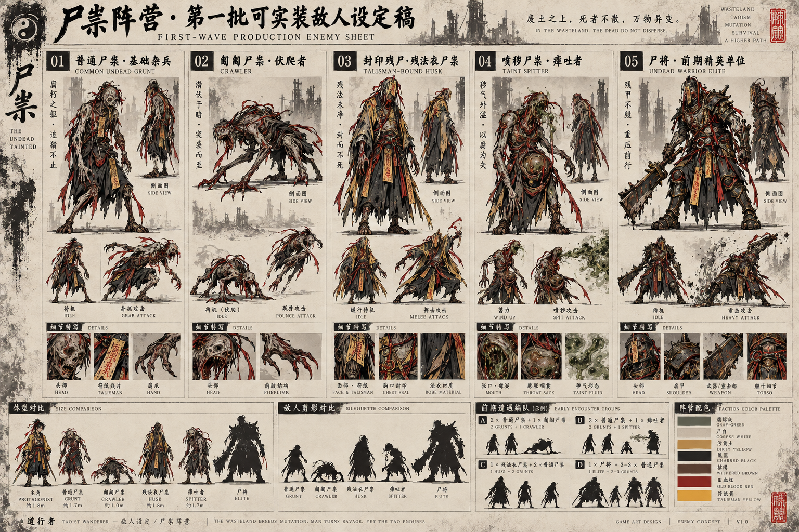
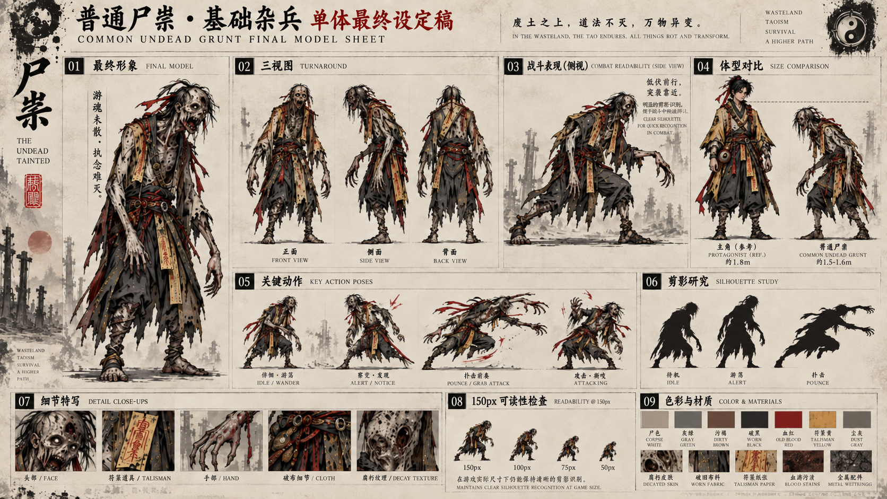
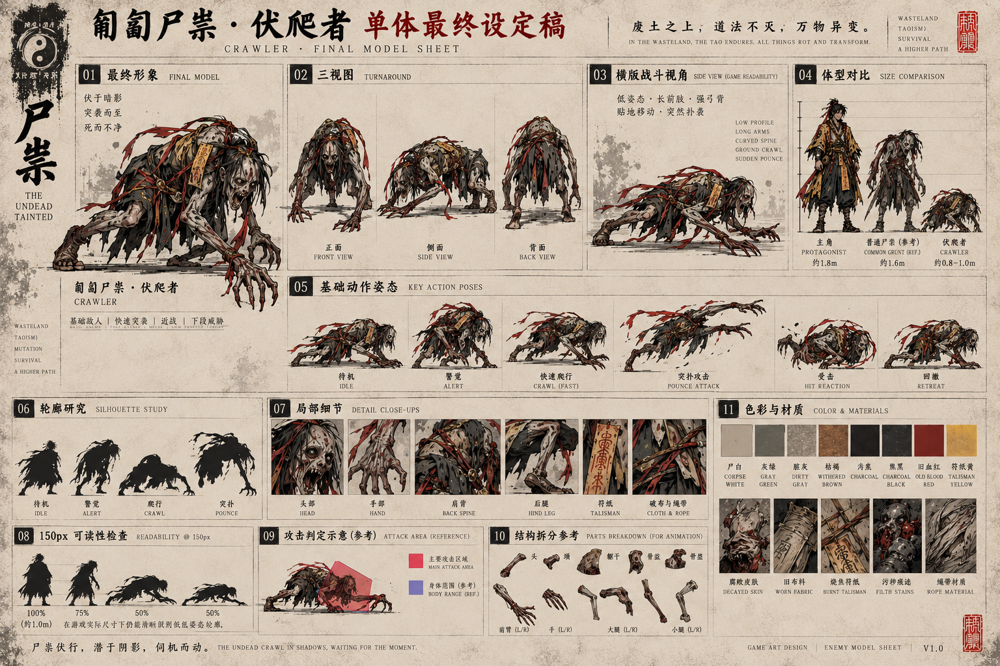
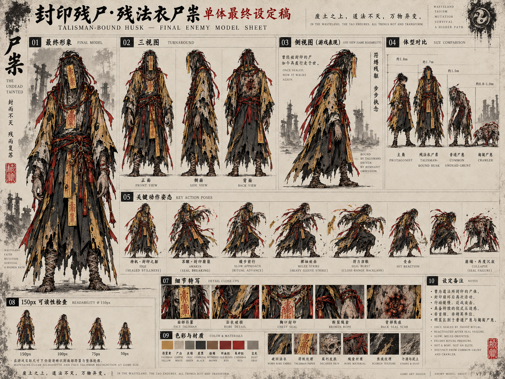
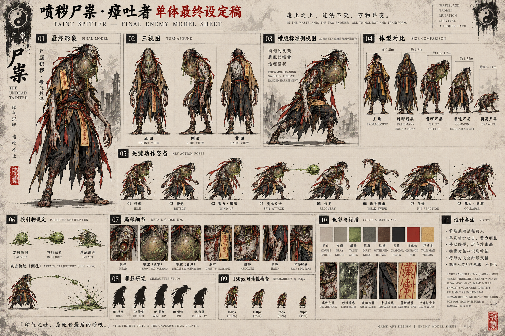

# 尸祟阵营·第一批可实装敌人（01–04）单体最终设定与战斗拆解规格书

> **阵营母题**：「废土之上，死者不散，万物异变。」  
> *In the wasteland, the dead do not disperse, all things mutate.*

本文档完整拆解 **尸祟·亡秽系（The Undead Tainted）** 第一批可实装敌人的总表（[`06_corpse_tainted_first_wave_sheet.png`](../concept_art/06_corpse_tainted_first_wave_sheet.png)）及前 4 个单位的 **单体最终设定稿（Final Enemy Model Sheets V1.0）**（[`07`–`10`](../concept_art/)），为程序、2D 动画师与战斗/关卡策划提供可直接落地的规格说明。（第 5 个单位《05 尸将·前期精英单位》详见专册 [`04_UNDEAD_WARRIOR_ELITE_SPEC_AND_REVISION.md`](./04_UNDEAD_WARRIOR_ELITE_SPEC_AND_REVISION.md)）。

---

## 一、第一批可实装敌人总览与前期遭遇编组（对应图 06）

### 1.1 第一批 5 类敌人的职能互补矩阵

为什么第一批锁定这 5 只敌人？因为它们在 **高度（中段/极低段/高大）、距离（近身扑咬/贴地突袭/中近压迫/远程抛射/大范围重兵）、节奏（快/慢/蓄力反制）** 上构成了最严密的横版动作基础教学闭环：

| 编号 | 单位名称（中 / 英） | 标语 | 身高标尺（主角 `1.8m=150px`） | 核心视觉锚点 | 核心战斗机制 |
| :---: | :--- | :--- | :---: | :--- | :--- |
| **01** | **普通尸祟·基础杂兵** `Common Undead Grunt` | *腐骨未寒，怨念不散* | `1.5–1.6m` （约 `130px`） | 佝偻前倾、干瘪死白、肩背破损黄符与断红绳 | 慢速游荡 → 发现玩家后短前摇猛扑撕咬（基础近战靶标） |
| **02** | **匍匐尸祟·伏爬者** `Crawler` | *伏于暗影，突袭而至* | 体长 `0.8–1.0m` （贴地高约 `55px`） | 极低贴地姿态、超长前肢、强弓背外露脊椎 | **低矮受击框（躲避上段平砍）** + 快速爬行突扑 + 扑后回撤 |
| **03** | **封印残尸·残法衣尸祟** `Talisman-Bound Husk` | *道法未净，封而不死* | `约 1.7m` （约 `142px`） | **大型朱砂黄符覆面**、残破道门法衣、胸口封印与断绳 | 缓慢沉重推进 + 挥袖重击 + **「符力溃散」近身爆发反制（防贪刀）** |
| **04** | **喷秽尸祟·瘴吐者** `Taint Spitter` | *秽气外溢，以腐为矢* | `1.6–1.7m` （约 `138px`） | **咽喉黄绿鼓胀喉囊 (Throat Sac)**、头颈极度前倾 | 喉囊发光膨胀蓄力 → **中远距抛物线腐液喷射 + 落地形成短暂毒潭** |
| **05** | **尸将·前期精英单位** `Undead Warrior Elite` | *残甲不毁，重压前行* | `2.0–2.2m` （约 `180px`） | 非对称旧铁残甲（尸 > 甲）、半脸护面、厚背崩口重砍刀 | 高韧性压迫推进 + 极清晰举刀蓄力前摇 + **竖劈砸地 / 大弧度横扫** |

### 1.2 前期标准遭遇战编组（Early Encounter Groups A / B / C / D）

图 06 右下角明确定义了前期关卡的 **4 组标准遭遇战配方**，关卡策划在布置前两章房间时应直接采用：

- **组合 A（高低段位夹击）**：`2 × 普通尸祟 + 1 × 匍匐尸祟`
  - **战术意图**：2 只普通尸祟在正面吸引玩家平砍，1 只伏爬者从地面贴地快速钻入。若玩家只顾无脑高段横斩（`03 横斩`），会打空伏爬者并被咬中下盘，从而引导玩家学会使用 **`04 下劈`** 或 **`06 冲刺斩`**。
- **组合 B（杂兵掩护 + 反制中坚）**：`2 × 普通尸祟 + 1 × 封印残尸`
  - **战术意图**：普通尸祟负责前排干扰，封印残尸缓步压上。玩家清理杂兵时若贴身连砍封印残尸过多，会触发其 **「符力溃散」** 近身震爆，引导玩家学会观察胸口/面部残符异动并及时闪避拉开，或用 **`08 符箓攻击`** 远程消耗。
- **组合 C（前排阻截 + 后排远程封路）**：`1 × 喷秽尸祟 + 2 × 普通尸祟`
  - **战术意图**：2 只普通尸祟卡住通道正面，后排喷秽者鼓起黄绿喉囊抛射腐液弹，在玩家脚下形成腐蚀毒潭。迫使玩家利用 **`06 冲刺斩`** 或 **`07 跳跃攻击`** 越过前排优先斩杀后排远程单位。
- **组合 D（前期精英守关战）**：`1 × 尸将 + 1–2 × 普通尸祟`
  - **战术意图**：前期小高潮战斗。玩家需先快速用范围技（如 **`10 念珠施法`** 或 **`08 符箓`**）清掉旁侧杂兵，随后专注读取尸将的大幅度举刀前摇，在重劈/横扫硬直期反击。

---

## 二、`01 普通尸祟·基础杂兵 (Common Undead Grunt)` 单体设定拆解（对应图 07）

### 2.1 核心设计规格
- **标语**：*「游魂不散，执念难灭」*
- **体型与姿态**：身高 `1.5–1.6m`（比主角 `1.8m` 矮一头），脊椎佝偻前倾，双臂无力前垂但指爪锋利僵硬；重心偏前，呈现「随时会向前猛扑」的失衡感。
- **横版侧视可读性要点（模块 03）**：
  - 「低伏前行，突然前扑」：在侧面视图中，前探的头颈与前伸的双爪必须与躯干分离出清晰的负空间（不可与胸腹重叠成一团），让玩家一眼看清爪击起手。

### 2.2 关键动作姿态（模块 05，共 4 组）
1. **`徘徊·游荡 (Idle / Wander)`**：双肩塌陷、头微低垂、双爪自然下垂，脚步拖沓缓慢移动。
2. **`警觉·发现 (Alert / Notice)`**：猛然抬头锁定玩家，双臂向两侧微张，口部裂开低吼，肩背残符微颤。
3. **`扑击前奏 (Pounce / Grab Wind-up)`**：双腿蹬地前冲、上半身极度前倾、双臂高举向前探出，形成极具侵略性的前扑张力线（给玩家约 `0.35s–0.45s` 的闪避/打断窗口）。
4. **`攻击·撕咬 (Attacking)`**：双爪由上而下猛烈抓挠并伴随撕咬，重心完全压向前方。

### 2.3 局部细节特写（模块 07，共 5 项）
1. **头部 (Face)**：死白干瘪面容、黑洞眼窝、干裂口唇露齿、散乱枯发。
2. **肩背道符 (Talisman)**：斜贴于左肩/后背的泛黄破损镇尸符，朱砂字迹暗淡模糊，证明封印早已松动失效。
3. **手部 (Hand)**：皮包骨的青灰枯爪，指尖淤黑带干涸血迹。
4. **破布细节 (Cloth)**：腐烂的灰褐麻布与断裂红绳缠腰，下摆呈锯齿状撕裂。
5. **腐肉肌理 (Decay Texture)**：锁骨、肋骨与肩胛处皮肤溃烂，露出暗红黑褐的干涸肌理。

---

## 三、`02 匍匐尸祟·伏爬者 (Crawler)` 单体设定拆解（对应图 08）

### 3.1 核心设计规格
- **标语**：*「伏于暗影，突袭而至，死而不净」* / *「尸祟伏行，潜于阴影，伺机而动」*
- **功能标签**：`基础敌人` | `快速突袭` | `近战` | `下段威胁`
- **体型与姿态**：体长约 `0.8–1.0m`，贴地高度仅 `0.55–0.75m`（不足主角腰部高度）。背部脊椎强烈弓起外露骨刺，前肢畸变修长有力，后肢萎缩弯曲贴地拖行。

### 3.2 基础动作姿态（模块 05，共 6 组）
1. **`待机 (Idle)`**：四肢贴地低伏潜藏，头微抬窥视，背部弓起如捕食蜘蛛/猎犬。
2. **`警觉 (Alert)`**：前肢撑起上半身、脊背高高拱起、张口嘶鸣，提示即将发起高速冲刺。
3. **`快速爬行 (Crawl Fast)`**：身体压至最低，修长前臂交替猛力抓地高速爬行逼近。
4. **`突扑攻击 (Pounce Attack)`**：后肢猛蹬地面，整个躯体向斜前方腾空飞扑，双爪大幅向前探出撕扯玩家下盘。
5. **`受击 (Hit Reaction)`**：被低段重击打翻，躯干向后蜷缩仰翻，碎布与尘土飞溅。
6. **`回撤 (Retreat)`**：一击未中或受创后，迅速向后缩身倒爬拉开距离，等待下一次突袭。

### 3.3 核心工程模块：攻击/受击判定框与 10 部件骨骼拆分（模块 09 & 10）

#### A. `09 攻击判定示意 (Attack Area Reference)`
- **蓝色框 — 身体受击范围 (Body Hurtbox)**：扁平贴地的长方形区域（高度仅占地面以上 `0px–55px`）。**设计目的**：主角常规站立平砍/高段横斩（判定高度在 `60px–130px`）会从伏爬者头顶直接掠过挥空！玩家必须使用 **`04 下劈`、`06 冲刺斩` 或 `07 跳劈`** 才能稳定命中。
- **红色框 — 主要攻击区域 (Main Attack Hitbox)**：位于伏爬者正前方至斜前上方的扇形前伸区域，随 `突扑攻击` 向前大幅延伸。

#### B. `10 结构拆分参考 (Parts Breakdown for Animation)`
为支持在 Godot (`Skeleton2D`) 或 Spine 中制作丝滑的贴地爬行与飞扑动画，图 08 专门提供了 **10 部件标准切件方案**：
1. `头颈 (Head & Neck)`
2. `上躯干 (Upper Torso - 含弓起胸腔与外露背脊)`
3. `下躯干 (Lower Torso - 含腰腹破布)`
4. `骨盆 (Pelvis)`
5. `前臂 L/R (Upper Forearms L/R)`
6. `前爪 L/R (Foreclaws / Lower Forearms L/R)`
7. `后腿 L/R (Upper Hind Legs L/R)`
8. `小腿 L/R (Lower Hind Legs / Feet L/R)`

---

## 四、`03 封印残尸·残法衣尸祟 (Talisman-Bound Husk)` 单体设定拆解（对应图 09）

### 4.1 核心设计规格
- **标语**：*「封而不灭，残而复行」* / *「曾被道法所封印的尸体，如今再度行走于世；符纸覆面，步履沉重」*
- **视觉与体型**：身高约 `1.7m`（接近主角 `1.8m`），体态直立修长而僵硬。面部正中贴有一张大型竖长朱砂镇尸符完全遮住五官，身披破烂不堪的暗褐/灰黑旧道门法衣，胸口贴有大型残损封印符，双臂与躯干缠满断裂的朱红封绳。
- **官方设定备注（模块 10，原图文字）**：
  - 曾为道法所封印的尸体，封印松动后再度活动；
  - 行动缓慢，近战攻击；
  - 具备独特的仪式压迫感；
  - **非施法，非远程单位**（严禁做成法师怪）；
  - 明显区别于普通尸祟（歪斜轻扑）与匍匐尸祟（贴地爬行）。

### 4.2 关键动作姿态（模块 05，共 7 组）
1. **`待机·封印之静 (Idle - Sealed Stillness)`**：如木桩般笔直僵立，双臂下垂拢于破袖中，头微低，伪装成场景中的静止封印死尸。
2. **`苏醒·封印崩裂 (Awaken - Seal Breaking)`**：当玩家靠近警戒半径，全身猛然震颤，双臂撑开断裂红绳，覆面黄符与胸口封印无风狂舞，散落碎符纸。
3. **`缓步前行 (Slow Approach - Ritual Advance)`**：步履沉重缓慢但带有小幅霸体韧性，一手微抬，向玩家稳步压迫推进。
4. **`挥袖攻击 (Melee Strike - Heavy Sleeve Strike)`**：利用缠满断绳与木枷残片的宽大破法衣长袖，带着沉重风压向前方猛力横抽/砸击。
5. **`符力溃散 (Seal Burst - Close-Range Backlash)`**（**核心特色机制**）：当受到连续近战打击或蓄势满额时，躯体后仰挺胸，胸口与面部失效封印瞬间爆开一团失控的暗金与黑红残余符力冲击波，震退并伤害贪刀的近身玩家（注：这是被动的近身封印溃散，而非主动远程施法）。
6. **`受击 (Hit Reaction)`**：身体僵直后退，残破法衣与碎符向后翻飞。
7. **`崩塌·再度沉寂 (Collapse - Seal Failure)`**：失去支撑跪倒坍塌成一堆破旧法衣与散落黄符。

---

## 五、`04 喷秽尸祟·瘴吐者 (Taint Spitter)` 单体设定拆解（对应图 10）

### 5.1 核心设计规格
- **标语**：*「腐秽积喉，吐瘴成灾；秽气不绝，喷吐不止」* / *「秽气之吐，是死者最后的呼吸」*
- **视觉与体型**：身高 `1.6–1.7m`，上身严重驼背前倾，脖颈向前下方伸出；**咽喉至上胸腔位置异化出一个极其醒目的半透明黄绿色鼓胀「喉囊 (Throat Sac)」**，内部翻涌发光腐液，嘴角与胸前挂满黄绿腐液流痕。
- **官方设计备注（模块 11，原图文字）**：
  - 前期基础远程敌人；
  - 单发喷吐攻击，蓄力明显；
  - 行动缓慢，近身能力弱；
  - **喉囊为核心识别特征**（即便缩至 `50px` 也能一眼看到胸前亮绿色的喉囊色块）；
  - 符纸为失效封印残留；
  - 风格约束：东方尸祟，不兽化、不虫化、不做成现代生化僵尸。

### 5.2 关键动作姿态（模块 05，共 8 组完整闭环）
1. **`01 待机 (Idle)`**：佝偻前倾站立，喉囊呈半充盈微鼓状态，呼吸间微弱起伏。
2. **`02 警觉 (Detect)`**：发现目标后头颈前探，双爪微张，喉囊开始泛起黄绿微光。
3. **`03 蓄力·膨胀 (Wind-up)`**（**核心前摇信号**）：身体向后上方吸气仰起，咽喉处的**喉囊剧烈膨胀至极限并散发醒目毒绿色光芒**，给玩家充足的远程预警。
4. **`04 喷吐攻击 (Spit Attack)`**：头颈猛然向前甩出，张口喷出一团浓稠的黄绿色腐秽液球，喉囊随之快速收缩。
5. **`05 恢复 (Recovery)`**：喷吐后身体因反冲与脱力向前低垂喘息，喉囊干瘪（此阶段为玩家近身输出的最佳硬直窗口）。
6. **`06 近身挥击 (Weak Swipe)`**：当玩家贴身时，极其笨拙缓慢地挥动单爪驱赶（伤害与判定均较弱，体现其「远强近弱」的定位）。
7. **`07 受击 (Hit Reaction)`**：受击后仰，喉囊剧烈晃动并飞溅少量绿液。
8. **`08 死亡·崩解 (Collapse)`**：喉囊破裂泄气，尸体向地面瘫软跪倒崩解。

### 5.3 核心工程模块：投射物三阶段与抛物线弹道设定（模块 06）
图 10 左下角专门定义了远程腐液投射物（`Taint Projectile`）的完整生命周期：
1. **`喷出瞬间 (Launch)`**：自口部喷发时的锥形雾化腐液与飞沫特效；
2. **`飞行状态 (In Flight)`**：椭球形浓稠腐液团核心（外裹暗绿毒气拖尾与滴落液滴），沿**中距离抛物线轨迹（Parabolic Trajectory）**飞行；
3. **`落地爆裂 (Impact)`**：接触地面或玩家时炸开黄绿色腐液水花，并在地面形成持续数秒的 **腐秽污染区（Taint Puddle）**，对踩入其中的玩家造成减速或持续腐蚀伤害，从而在横版空间中起到分割战场、逼迫跳跃/冲刺的作用。
