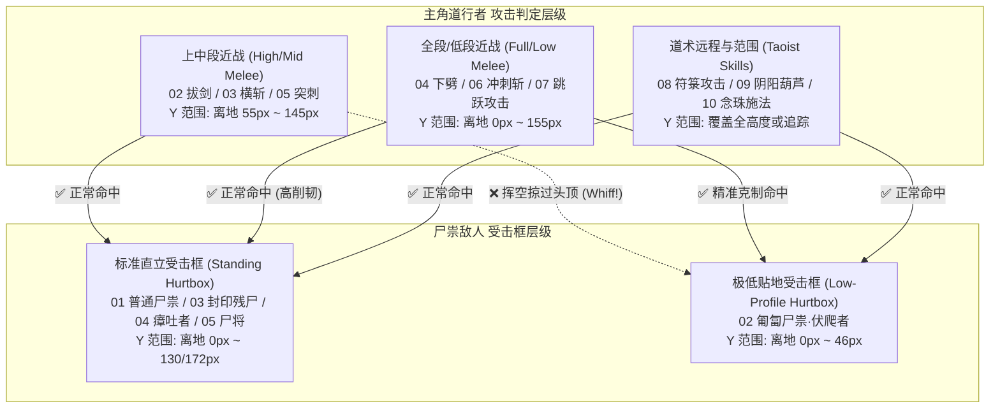
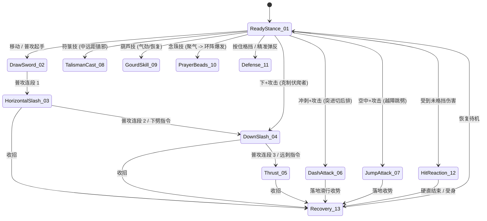
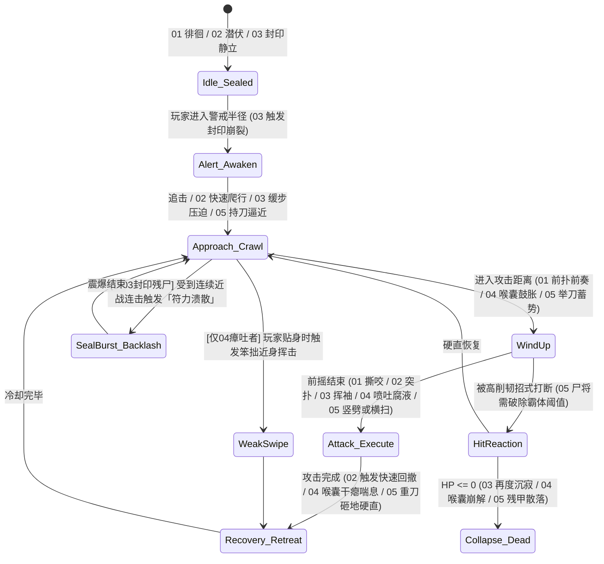

# 开发团队工程对接指南与资产制作路线图 (Developer Handoff Guide & Production Roadmap)

本文档面向 **程序（Gameplay / 引擎）、动画师（Spine / 逐帧 / 2D 骨骼）、原画美术、战斗与关卡策划**，将《道行者 / Taoist Wanderer》第一批设定物料转化为可直接执行的工程参数、状态机规范、资产验收标准与后续研发排期路线图。

---

## 一、跨职能团队快速对接总表（Who Reads What）

| 职能角色 | 核心交付物入口 | 第一阶段核心开发任务 |
| :--- | :--- | :--- |
| **Gameplay 程序** | [`02_PROTAGONIST_SPEC.md`](./02_PROTAGONIST_SPEC.md) [`03_FIRST_WAVE_ENEMIES_SPEC.md`](./03_FIRST_WAVE_ENEMIES_SPEC.md) 本文档第二节 | 1. 搭建 `1.8m = 150px` 横版角色控制器与 13 招式状态机； 2. 实现高/低段位分离的 Hitbox/Hurtbox 系统（验证伏爬者躲上段斩、吃下劈）； 3. 实现第一批 5 类尸祟 AI 状态机、抛物线毒弹 + 地面毒潭、封印残尸近身反制与尸将高韧性重击 |
| **2D 原画美术** | [`01_WORLD_AND_ART_BIBLE.md`](./01_WORLD_AND_ART_BIBLE.md) [`04_UNDEAD_WARRIOR_ELITE_SPEC_AND_REVISION.md`](./04_UNDEAD_WARRIOR_ELITE_SPEC_AND_REVISION.md) | 1. 使用 `04` 文档中的 V1.1 修正版 Prompt 产出《05 尸将·前期精英单位 单体最终设定稿 V1.1》； 2. 按 11 模块工业标准推进第二批尸祟（`06 重型亡秽体`、`07 小BOSS`、`08 秽骨之王`）与首章废墟/道观场景设定 |
| **2D 动画 / 特效** | [`concept_art/01`–`10`](../concept_art/) 本文档第三节 | 1. 按 `150px` 基准与脚底中心锚点（Bottom-Center Pivot）制作主角与前 5 类敌人的战斗序列帧或骨骼分件（参考图 08 伏爬者 10 部件拆分）； 2. 制作道剑红白墨韵剑气、金火符箓轨迹、葫芦气旋、念珠法阵及喷秽者三阶段毒液特效 |
| **关卡 / 战斗策划** | [`01_WORLD_AND_ART_BIBLE.md`](./01_WORLD_AND_ART_BIBLE.md) [`03_FIRST_WAVE_ENEMIES_SPEC.md`](./03_FIRST_WAVE_ENEMIES_SPEC.md) | 1. 基于 `Group A / B / C / D` 标准编组搭建前 20–30 分钟核心验证关卡（荒村废墟 → 道路边缘 → 低洼污染区 → 废弃道观 → 乱葬岗尸将战）； 2. 调校前摇帧数、削韧值（Poise）与攻击距离 |

---

## 二、程序与战斗工程实现规范（Gameplay & Engine Specs）

### 2.1 全局像素与物理比例换算总表（`1.80m = 150px` 标准标尺）

所有角色与怪物均以 **脚底中心点（Bottom-Center `(0, 0)`）** 为根节点原点（Root Pivot），确保不同体型单位站在同一横版地面（Ground Y）时严丝合缝：

| 单位 ID | 单位名称 | 设定身高 (m) | 标准像素高 (`1x`) | 高清资产高 (`2x`) | 受击框尺寸 `(W × H px)` | 建议移速 (`px/s`) | 韧性/霸体等级 | 核心判定特性 |
| :--- | :--- | :---: | :---: | :---: | :---: | :---: | :---: | :--- |
| `taoist_wanderer` | **主角·道行者** | `1.80m` | **`150 px`** | `300 px` | `44 × 138` | `260`（冲刺 `520`） | 玩家韧性（格挡可弹反） | 拥有上段（横斩/突刺）、全段/低段（下劈/冲刺斩/跳劈）、远程（符箓）、周身（念珠）四维判定 |
| `01_common_grunt` | **普通尸祟·杂兵** | `1.58m` | **`132 px`** | `264 px` | `46 × 124` | `95`（扑击 `280`） | 低（普攻即硬直） | 标准中段受击框；前扑攻击有 `0.4s` 明显前倾张爪前摇 |
| `02_crawler` | **匍匐尸祟·伏爬者** | `0.90m`（长） `0.65m`（高） | **`54 px`**（高） `115 px`（长） | `108 px`（高） `230 px`（长） | **`92 × 46`（贴地扁盒）** | `215`（突扑 `440`） | 低（受低段重击仰翻） | **受击框顶高仅 `46px`**：免疫离地 `>55px` 的上段水平斩击；需用下劈/冲刺斩/跳劈命中 |
| `03_talisman_husk` | **封印残尸·残法衣** | `1.72m` | **`144 px`** | `288 px` | `50 × 138` | `65`（沉重缓步） | **中高（小霸体）** | 承受连续近身攻击或蓄满计数器时触发 **「符力溃散」** 周身半径 `110px` 震爆反制 |
| `04_taint_spitter` | **喷秽尸祟·瘴吐者** | `1.66m` | **`138 px`** | `276 px` | `52 × 130` | `75` | 低（蓄力可被重击/符箓打断） | 远程抛物线弹道（射程 `220px–520px`），落地生成半径 `65px`、持续 `4.5s` 的腐蚀毒潭 |
| `05_undead_warrior` | **尸将·前期精英** | `2.15m` | **`180 px`** | `360 px` | `72 × 172` | `85`（压迫推进） | **高（强霸体护甲）** | 常态推进不被轻攻击打断；重劈（纵向高伤+震地）与横扫（横向宽幅）前摇 `0.65s–0.85s` 极清晰 |

---

### 2.2 高低段位分离与碰撞层（Collision & Hitbox/Hurtbox Architecture）

为还原图 02、图 08、图 10 中的核心战斗交互，引擎碰撞层必须遵循以下规则：

---

### 2.3 核心状态机规范（Finite State Machines）

#### A. 主角「道行者」战斗状态机（对应图 02 的 13 组姿态）

#### B. 第一批尸祟敌人 AI 状态机闭环

---

## 三、美术与动画工业化管线规范（Art & Animation Pipeline）

### 3.1 单体最终设定稿（Final Enemy Model Sheet）11 模块工业标准
后续所有新敌人（含 Batch 1.5 尸将 V1.1、Batch 2 重型亡秽体/小Boss/秽骨之王，以及其余五大阵营单位）的单体最终设定稿，必须严格包含以下 **11 个标准化模块**：
1. **`01 最终形象 (Final Model)`**：左侧全身主视觉，确立核心气质、材质层次与第一视觉焦点。
2. **`02 三视图 (Turnaround)`**：同比例正面 / 侧面 / 背面，严禁只画正面导致背部结构缺失。
3. **`03 横版标准侧视图 (Side-View Game Readability)`**：100% 服务横版战斗视角的标准侧视姿态，重点检验武器/前肢与躯干的分离度。
4. **`04 体型对比 (Size Comparison)`**：同一地平线对比主角（`1.8m`）与同阵营其他单位的真实身高与宽度。
5. **`05 关键动作姿态 (Key Action Poses)`**：完整覆盖 `待机 → 警觉/苏醒 → 移动/逼近 → 蓄力前摇 → 攻击（含特色招式）→ 受击/恢复 → 死亡崩解` 的横版动作链。
6. **`06 特殊机制 / 武器 / 投射物 / 骨骼拆分专有模块`**：
   - 如伏爬者提供 `攻击判定示意 + 10 部件骨骼拆分`；
   - 如喷秽者提供 `投射物三阶段 + 侧面抛物线轨迹`；
   - 如尸将提供 `重砍刀独立拆解规格区`。
7. **`07 剪影研究 (Silhouette Study)`**：抽取 4–5 个核心状态的纯黑剪影，检验无内线时的辨识度。
8. **`08 150px 可读性检查 (Readability @ 150px / 100px / 75px / 50px)`**：四级游戏内尺寸实测。
9. **`09 局部细节特写 (Detail Close-ups)`**：5–7 个关键部位放大图（头部、符箓、手爪、武器局部、伤口/胸背封痕）。
10. **`10 色彩与材质 (Color & Materials)`**：标准色卡 + 5 个核心材质球。
11. **`11 设计备注 (Design Notes)`**：以简练条目锁死战斗定位、AI 行为特征与风格禁区（如“非远程法师”、“尸大于甲”）。

---

## 四、后续资产研发路线图（Next-Batch Asset Roadmap）

### Batch 1（当前已交付 — 本仓库现有资产）
- ✅ 主角「道行者」最终装备设定 V2、战斗姿态设定 V1.0、表情与情绪设定（共 3 张母版 + 完整规格书）
- ✅ 世界观六大敌人生态总设定、尸祟阵营八阶总览、尸祟第一批可实装敌人总表（共 3 张母版 + 完整圣经）
- ✅ `01 普通尸祟`、`02 匍匐尸祟·伏爬者`、`03 封印残尸·残法衣尸祟`、`04 喷秽尸祟·瘴吐者` 单体最终设定稿（共 4 张母版 + 完整战斗拆解）
- ✅ `05 尸将·前期精英单位` 完整 27 节设定规格书 + V1.0 评审诊断 + V1.1 生产修正 Prompt

### Batch 1.5（紧接下一步）
- 🔜 产出 **《05 尸将·前期精英单位 单体最终设定稿 V1.1》**（执行「尸 > 甲」、非对称残甲、半脸护面、重刃缩减 10%–15%、红布减少 20%–30% 五大修正）
- 🔜 导出主角与第一批 5 类尸祟敌人的游戏内透明通道序列帧 / 2D 骨骼分件包，完成首章横版战斗白盒 Demo（Whitebox Combat Prototype）

### Batch 2（尸祟阵营中后期高阶单位）
- 📋 **`06 重型亡秽体 (Heavy Abomination, ~2.8m)`** 单体最终设定稿
- 📋 **`07 小BOSS·守墓巨魂/仪式残骸 (Mini Boss, ~3.4m)`** 单体最终设定稿
- 📋 **`08 章节大BOSS·秽骨之王 (Lord of the Blight, ~4.5m+)`** 多阶段形态与招式最终设定稿

### Batch 3（首章横版关卡环境与交互物件）
- 📋 四大核心区域横版多层视差场景概念与组件表（荒村废墟 → 污染荒野 → 残破道观 → 地下封印遗迹）
- 📋 关卡交互资产：篝火调息点、破损道门石碑、可破坏封魔坛、瘴气毒沼地块、遗迹机关门

### Batch 4（其余五大阵营依次展开）
- 📋 `02 邪修·堕道者` → `03 畸变兽·污染生物` → `04 废土人类势力` → `05 道门异化体` → `06 遗迹守御体`
