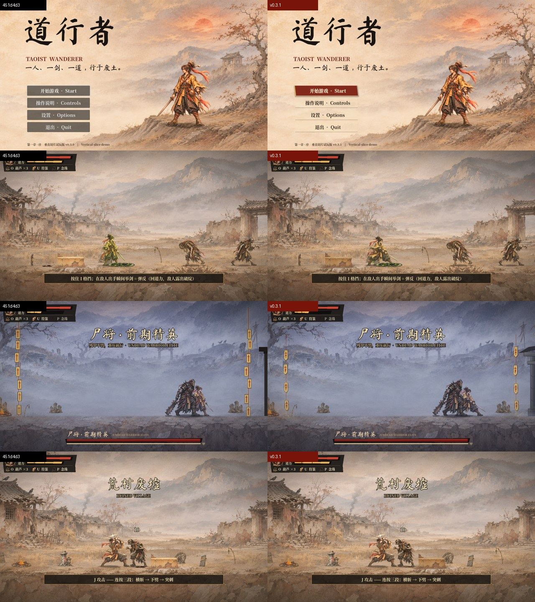

# 0.3.1 · 接手验证与画面修整

基线：Codex 最新提交 `451d4d3`（比已发布 RC1 `93cee6d` 新 5 个提交，含逐帧动画、2.5D 光照、打击感与标题/结局）。
分支：`claude/post-codex-continuation`。



同一测试脚本（`game/tests/test_runner.gd` 的 `titlecap`、`showcase`、`gatecap` 模式）分别在 `451d4d3` 工作树与本分支上运行，Xvfb + 软件 GL，1280×720，`--fixed-fps 60`。原图在 [before/](before) 与 [after/](after)。

## 基线验证（451d4d3，未修改前）
- 干净导入：成功（首次导入时字体尚未导入的 4 行报错属正常顺序问题，二次启动无报错）。
- `--test=all`：52/52 通过。
- 通关机器人：完整通关，0 死亡，24 击杀。
- 完整渲染通关录像（movie writer，2:56）逐区审查：荒村、道路边缘、低洼污染区、废弃道观、乱葬岗与尸将。

## 录像审查发现并已修复
| 问题 | 证据 | 修复 |
| --- | --- | --- |
| 两次出招之间主角闪回正面 3/4 待机图（其余动作均为侧面），每次连击间隙身体“转身”一次 | 首战逐帧条 | 战斗中（出招/格挡/受击/技能后 2.6 s 或 430 px 内有敌）保持侧身持剑守势；战斗结束后才回到放松待机。回归测试 `guard_stance` |
| 尸将战提示条压在地面线，遮住双方脚部与招式 | 尸将战 1:54 | Boss 战时提示条移到 Boss 名牌下方的天空带 |
| 伤害数字叠印 | 首战逐帧条 | 同一目标 0.42 s 内的数字向上堆叠 |
| 终点光门为纯黑矩形占位 | 乱葬岗右侧 | 有明暗与檐角的石牌坊、匾额、地面薄雾 |
| 结界为通屏高的“梯子” | 各战斗区 | 由地面符阵升起并向上渐隐的光幕，四张悬符 |
| 粒子为硬方块，与手绘风格冲突 | 尸将近景 | 统一柔边圆点 |
| 地面血墨渍为不透明黑椭圆，像地面破洞 | 多处 | 半透明渗染、柔边，存在 5 s |
| 平台（砖墙等）全饱和，像贴纸 | 荒村 | 采用所在区的阴影色调 + 接地软影 |
| 站在毒池中主角整身变橄榄绿 | 低地/showcase | 毒池点光强度减半并降饱和，轻度色偏 + 腿部瘴气 |
| 菜单为 Godot 默认灰色方块 | 标题/暂停/设置 | `InkTheme`：墨色底板、朱砂聚焦印、金边；标题页闲置项为墨字细线 |

## 测试结果（本分支）
- 源码 `--test=all`：54/54（新增 `guard_stance`、`personal_space`）。
- 通关机器人：完美模式 3 次全部通关（0–1 死亡），拟人模式 1 次通关（1 死亡）。
- 导出包：`package.py 0.3.1` 生成 Linux / Windows / macOS 三个 ZIP。从 Linux ZIP 解压出的可执行文件内运行 `--test=all` 53/53、通关机器人通关，并在 Xvfb 下渲染截图正常。
- Linux ZIP（SHA-256 `4dd5c284…3ec2e6`）经 `tools/qa/native_release.py`（Xvfb + llvmpipe）：解压可执行、引擎检查、常规通关、浸泡测试均通过；`title`/`village` 两项被判失败，原因仅是容器无声卡（ALSA 打不开设备，Godot 回退到哑音频驱动并输出 ERROR），截图渲染正常（[native/linux-village.png](native/linux-village.png)，[原始结果](native/linux.json)）。
- Windows 与 macOS 包已生成，**本环境未运行**（无 Windows / macOS 主机）。

## 未解决 / 需人工
- 真人试玩、实体手柄、扬声器听感仍未做。
- 敌我贴身时精灵大面积重叠，近身读招仍偏难（未改碰撞，避免影响已验证的判定）。
- ~~念珠空中悬停~~：逐帧复查为正常下落弧线，非缺陷。
- ~~关卡平台贴图被横向压缩~~（已修复，见 platforms.jpg，左旧右新）。

## 后续追加（同一版本内）
| 问题 | 修复 |
| --- | --- |
| 主角走进敌人时两个完整人物叠在同一位置 | 直立敌人在中立状态被推开到最小间距（冲刺/空中/敌方出招时不推），测试 `personal_space` |
| 平台画作被横向压缩 | 按高度等比缩放，以画作左右两端拼合（[platforms.jpg](platforms.jpg)，左旧右新） |
| HUD 头像方角露出铜环 | 头像裁成柔边圆形（[after/hud.png](after/hud.png)） |
| 尸将“已镇”英文行用毛笔字体，拉丁字母无法辨认 | 英文行改用正文衬线体（[before](before/seal_caption.png) / [after](after/seal_caption.png)） |

## 最终包（提交 `72714c7`）
```
e9add65052618a2954d769beb1aa9e8eb5328a617f80eaff4bdc3afd68ff9bbd  TaoistWanderer-v0.3.1-linux-x86_64.zip
e8d9d905e545bfdbda6a9fd44480556ad4b4bbf3bc8cc782a82bdb7266d07998  TaoistWanderer-v0.3.1-windows-x86_64.zip
1b4a3121bb87f0267597a1d7e324703b536a3dcbff05d1f635c9276869855a10  TaoistWanderer-v0.3.1-macos-universal.zip
```
Linux 包解压后运行：`--test=all` 54/54，通关机器人通关（1 死亡）。最终完整渲染通关录像（2:59 游戏时间，0 死亡）复查五区与尸将，llvmpipe 下平均 CPU 9.9 ms/帧、GPU 10.6 ms/帧（movie writer 统计，非实机 GPU）。Windows / macOS 包未在对应系统运行。包未发布（`build/` 不入库）。
