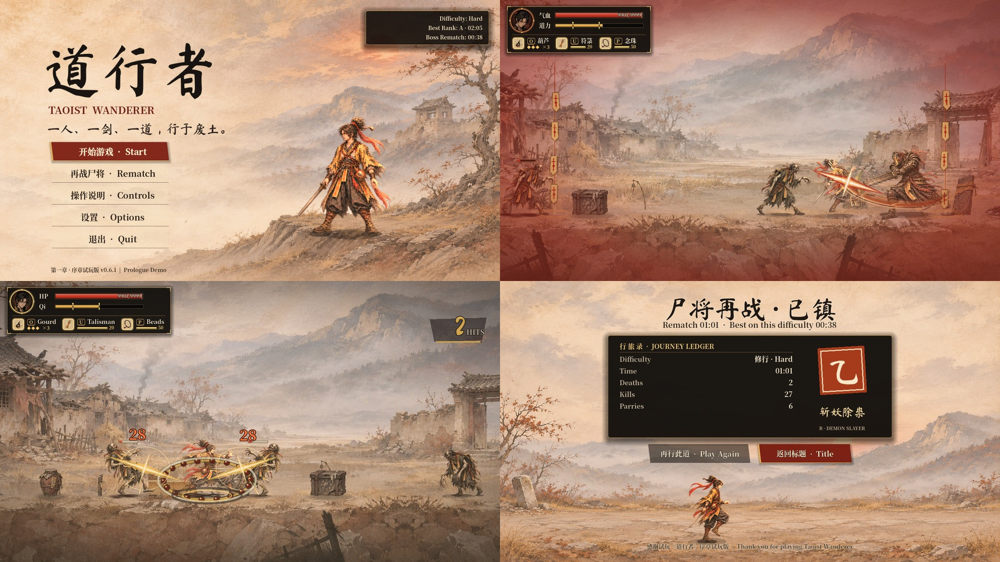

# Evidence — Taoist Wanderer (道行者) v0.6.1 Public Playtest Pre-release

Verified on Apple Silicon (`macOS-27.2.1-arm64`, `Apple M6`, Godot `4.7.2.stable.official.ed1daf0bf`, Metal `1280×720`) following the **Gemini 4 Neon × Grok 4.7** dual-model cross-validation stabilization pass. **Automated checks and bots are not human approval of feel, art, or audio.**



## Verification Summary

| Gate | Result | Details |
| --- | --- | --- |
| Engine suite (`--test=all`, source) | **99/99 PASS** | Zero `SCRIPT ERROR`, `ERROR:`, or warnings; includes 9 new regression checks covering cold-launch title progress, boss chop cleave/parry ordering, opening input lock, boss death summon cleanup, lethal block & respawn `knock_v`, LoreReader pause guard, Options gamepad scroll/cancel & rebinding, difficulty rank exploit guard, and telegraph/localization/font polish |
| One-command smoke (`tools/qa/smoke.sh`) | **PASS** | `99/99` + Bot 0-death Normal clear (`02:04`, `25 kills`, `5 parries`, `rank=甲`), fully isolated `--qa-settings`/`--qa-run` |
| Full route & soak (`--test=soak`, source) | **PASS** | Two consecutive 0-death Normal clears (`rank=甲`); `soak_no_leak PASS` (`nodes 87->87`, `orphans 0->0`) |
| Human-like bot (`--bot_skill=human`) | **PASS** | 0 deaths, `25 kills`, `5 parries`, `rank=甲`, `尸将:chop = 30.0` |
| Audio review (`tools/audio/audio_review.py`) | **75/75 PASS (0 flagged)** | `44.1 kHz`, 30 stereo + 45 mono (`26.14 MB`), max peak `-1.00 dBFS`, max loop seam `0.0115` |
| Real-GPU Metal `perfcap` (`q1` `1280×720`) | **Verified** | `village p50=9.58 / p99=17.43 ms`; `lowland p50=10.43 / p99=16.20 ms`; `burial_wave p50=11.80 ms`; `elite p50=11.43 ms` |
| Native macOS `.app` (`native_release.py`) | **4/4 PASS** | Unpacked `TaoistWanderer-v0.6.1-macos-universal.zip`: `codesign --verify --deep --strict`, `engine` (`99/99` PASS), `normal-route` (0 deaths, `rank=甲`), rendered `title` (clean isolated save) & `village` all PASS; see [native-macos-arm64.json](native-macos-arm64.json) |
| Windows & Linux packages | **Built + CI Native Check** | Exported with embedded PCK and full `playtest/` docs (`README.md`, `PLAYTEST_GUIDE.md`, `KNOWN_ISSUES.md`, `FEEDBACK_TEMPLATE.md`, `ASSETS_AND_CREDITS.md`); verified via `.github/workflows/native-release.yml` |

## Real-GPU Metal Screenshots (`shots/`)

- [`01_title_zh.png`](shots/01_title_zh.png) — Clean Chinese title screen (`v0.6.1`)
- [`02_title_cold_en.png`](shots/02_title_cold_en.png) — Cold-launch English title verifying synchronous settings load (`再战尸将 · Rematch` + `Difficulty: Hard / Best Rank: A · 02:05 / Boss Rematch: 00:38`)
- [`03_village.png`](shots/03_village.png) — Ruined Village rendered directly from unpacked macOS `.app`
- [`04_elite_clash.png`](shots/04_elite_clash.png) — Undead General combat clash
- [`05_beads_burst.png`](shots/05_beads_burst.png) — Prayer Beads ring burst (Chinese HUD)
- [`06_pause_en.png`](shots/06_pause_en.png) — Full `1280×720` English pause menu (`Down slash S / Down + J`, no clipping)
- [`07_ending_rematch_en.png`](shots/07_ending_rematch_en.png) — English Boss Rematch Journey Ledger
- [`08_beads_burst_en.png`](shots/08_beads_burst_en.png) — English combat HUD (`HP / Qi / Gourd / Talisman / Beads` + `2 HITS`)

## SHA-256 (`SHA256SUMS`)

```
2a0cba1d922137467f46e8e1069aab603953e3ef83be93a4b5565fe341a50abd  TaoistWanderer-v0.6.1-linux-x86_64.zip
482f65529308b122ac22ca116e926c220294713ac3913c2c00906b17694d70bd  TaoistWanderer-v0.6.1-windows-x86_64.zip
2dbfb320b56f1c348624dd9dc50f4b03cded30d30555342d3290ac4a8506ee77  TaoistWanderer-v0.6.1-macos-universal.zip
```

## Still Pending (Human / Hardware Only)

Human playtesting; speaker/headphone audition; physical controller (incl. vibration feel & Nintendo A/B layout); Intel Mac hardware; native-speaker English proofreading.
