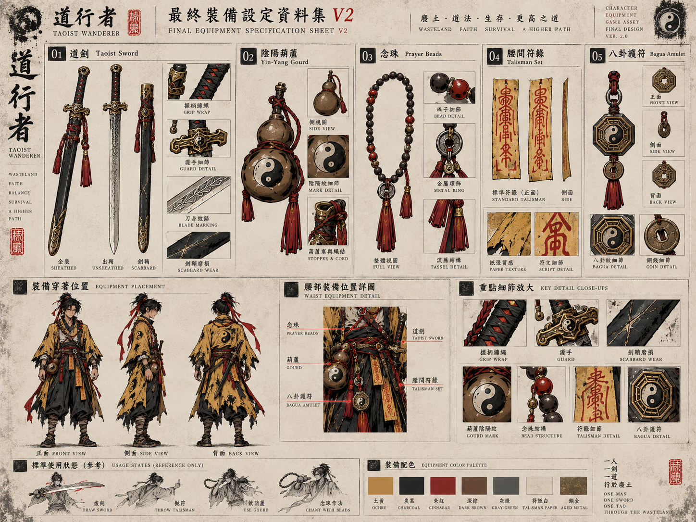
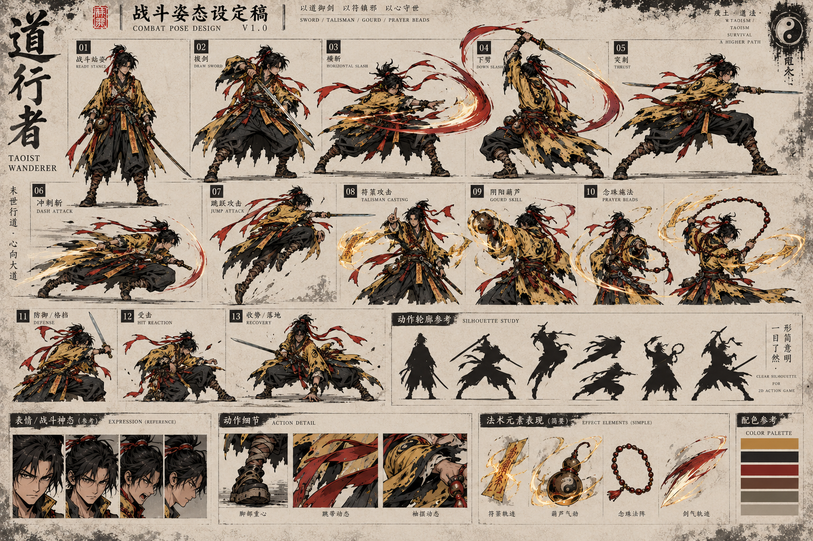
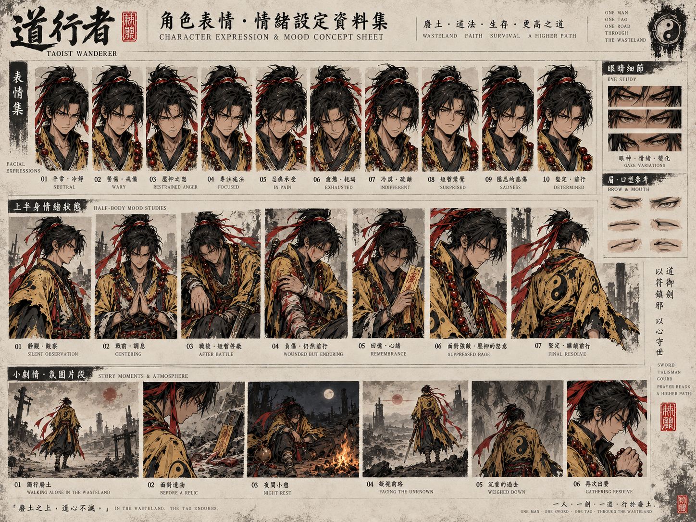
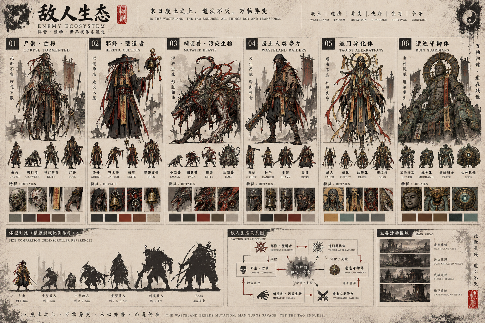
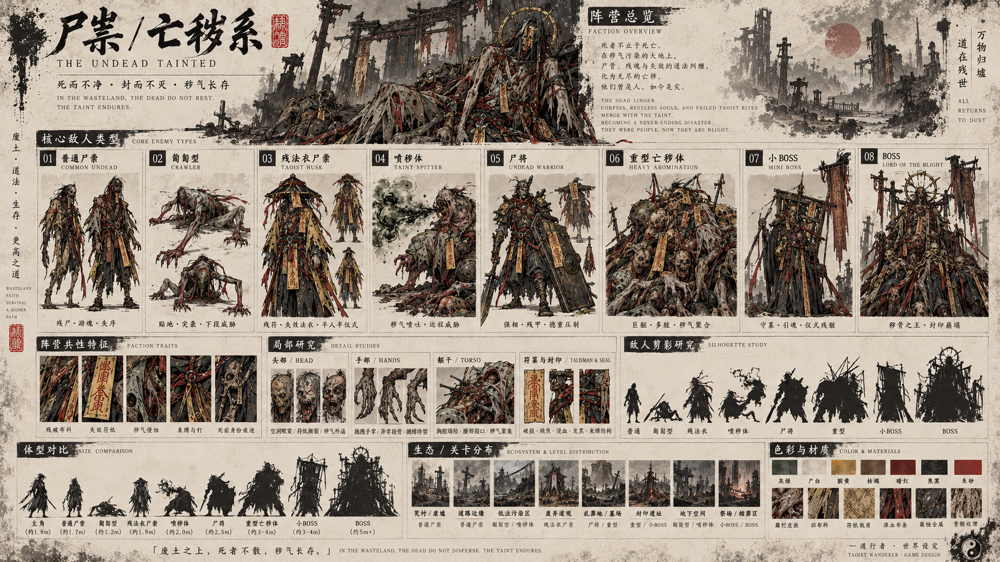
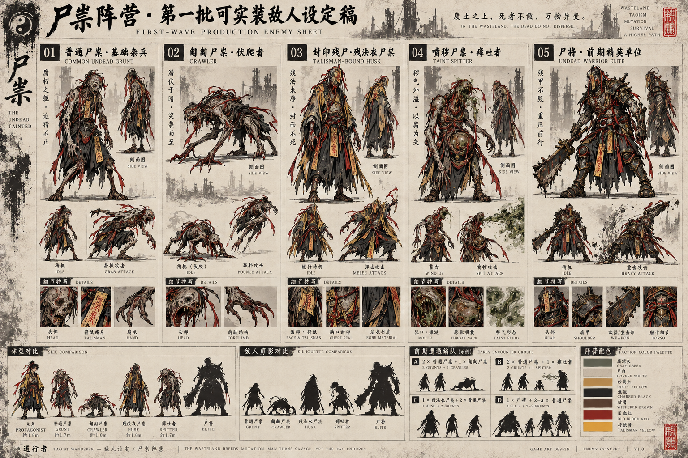
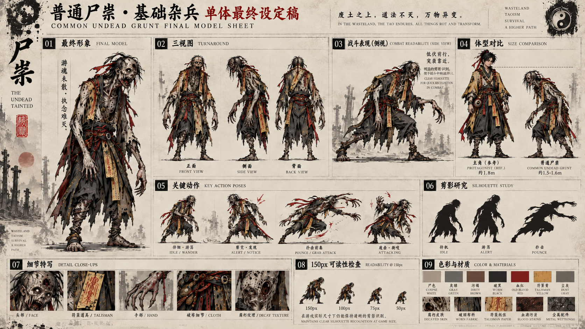
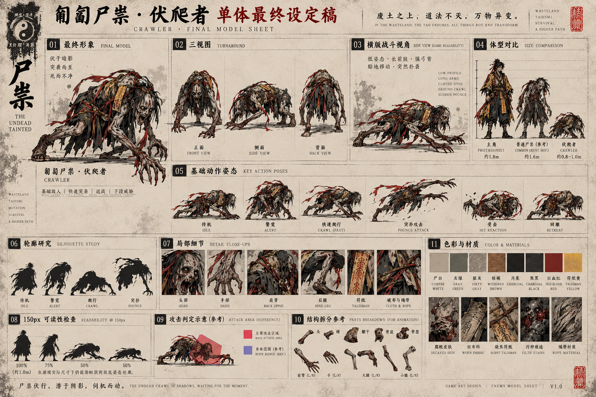
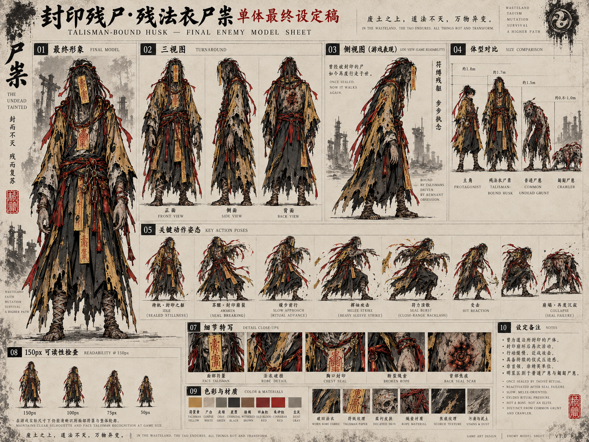
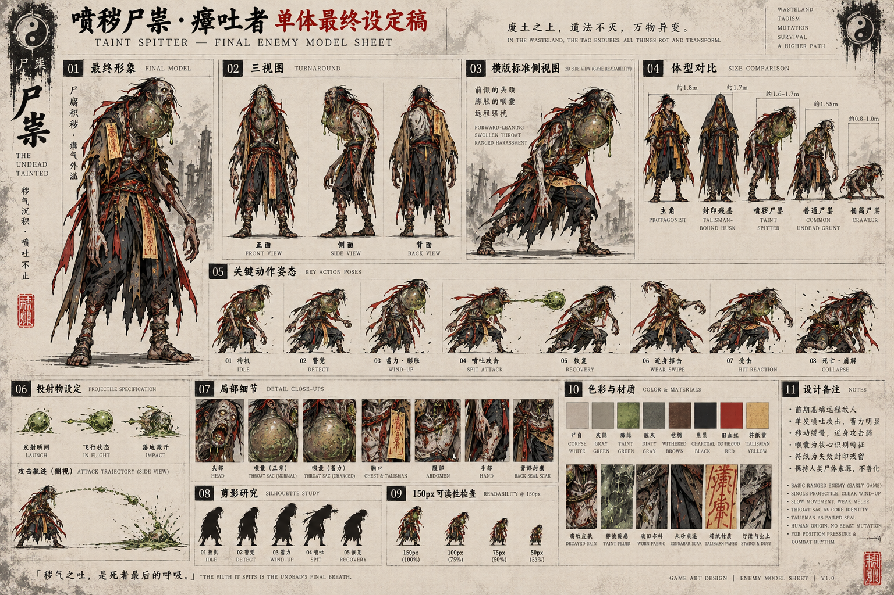

# ChatGPT 对话完整原始记录：《游戏素材制作教程》

- **Conversation ID**: `6aa261fe-5710-83ea-b677-258c882b25cd`
- **Title**: `游戏素材制作教程`
- **Source Kind**: `chatgpt`
- **Turns Retrieved**: `5` (`hasMore: False`)
- **Images Retrieved**: `10`

---

## 一、对话中获取的 10 张原始设定图

### 01. 道行者·法器与装备拆解 (V2 优化版)
- **原始文件名**: `598f3302-14b8-4e04-a462-a0730df47598.png`
- **本地保存路径**: `../concept_art/01_protagonist_equipment_v2.png`

### 02. 道行者·战斗动作设定 (V1)
- **原始文件名**: `e42d41f5-3d61-444c-ad4b-2b05013ef000.png`
- **本地保存路径**: `../concept_art/02_protagonist_combat_poses_v1.png`

### 03. 道行者·表情与状态氛围设定
- **原始文件名**: `cb54547c-dd6d-42a0-bc89-edc2a5ce281d.png`
- **本地保存路径**: `../concept_art/03_protagonist_expressions_mood.png`

### 04. 道行者·敌人生态总设定 (Enemy Ecosystem Overview)
- **原始文件名**: `fcd3b2a7-2ff3-45a2-b03b-90ef3cdf44e6.png`
- **本地保存路径**: `../concept_art/04_enemy_ecosystem_overview.png`

### 05. 道行者·尸祟·亡秽系详细设定 (Corpse-Tainted / Undead Faction Overview)
- **原始文件名**: `087f5e6a-bf34-452c-b42c-583d8baf1e1b.png`
- **本地保存路径**: `../concept_art/05_corpse_tainted_faction_overview.png`

### 06. 尸祟·亡秽系 第一批可实装敌人设定 (First-Wave Enemies Concept Sheet)
- **原始文件名**: `d9b67c1f-0718-4442-8cdd-367c3454e337.png`
- **本地保存路径**: `../concept_art/06_corpse_tainted_first_wave_sheet.png`

### 07. 普通尸祟·单体最终设定稿 (Common Undead — Final Enemy Model Sheet)
- **原始文件名**: `e38b407b-baf8-4129-89b0-b1cb43e66d1b.png`
- **本地保存路径**: `../concept_art/07_common_undead_grunt_sheet.png`

### 08. 匍匐尸祟·伏爬者 单体最终设定稿 (Crawler / Low-Profile Undead — Final Enemy Model Sheet)
- **原始文件名**: `65d71250-d453-4c0e-9a68-28802b1dff48.png`
- **本地保存路径**: `../concept_art/08_crawler_sheet.png`

### 09. 封印残尸·残法衣尸祟 单体最终设定稿 (Talisman-Bound Husk — Final Enemy Model Sheet)
- **原始文件名**: `6afe53eb-b0f8-48ed-ad66-54698fc6ac31.png`
- **本地保存路径**: `../concept_art/09_talisman_bound_husk_sheet.png`

### 10. 喷秽尸祟·瘴吐者 单体最终设定稿 (Taint Spitter — Final Enemy Model Sheet)
- **原始文件名**: `a70ed1b1-7b93-4f13-b777-c3c098d76920.png`
- **本地保存路径**: `../concept_art/10_taint_spitter_sheet.png`

---

## 二、对话完整文字记录（按时间正序，一字未改）

### Turn 1 (`6aa877c3-68b9-47f1-9835-1d90f6bf148b`)

#### 【User】

下一个敌人单体 是？

#### 【Assistant】

下一个就是这批 5 个可实装敌人里的第 5 个：

**《尸将·前期精英单位 单体最终设定稿》**  
英文可以用：**UNDEAD WARRIOR ELITE — FINAL ENEMY MODEL SHEET**

它正好接在：

**普通尸祟 → 伏爬者 → 封印残尸 → 瘴吐者 → 尸将**

后面。

这只的定位会和前四只明显不一样：**前期精英 / 重压型近战单位**，不是 Boss，但要第一次让玩家明显感觉到“尸祟里也有上位个体”。

它的核心方向我建议锁成：**重、稳、压、砸、残甲**。体型比主角明显更厚重，带残破甲片和大面积秽气侵蚀，可以使用一件非常粗粝的重击物，比如残门板、断碑、厚重破铁器，但不能做得像正式武将或 Boss。

这个单体页重点就应该锁：
**最终造型 + 三视图 + 横版侧视 + 重型待机 + 缓慢压近 + 重砸 + 横扫/推撞 + 受击硬直 + silhouette + 150px可读性 + 主角/前四只敌人的体型对比 + 武器/重击部位拆解**。

而且这张很关键，因为它会是**第一批敌人里“杂兵体系到精英体系”的分界点**。

你要的话，我下一条就直接给你完整的 **《尸将·前期精英单位 单体最终设定稿》prompt**。

---

### Turn 2 (`c303277d-a35f-4bfb-8c99-43488b133ec7`)

#### 【User】

完整 的《尸将·前期精英单位 单体最终设定稿》prompt

#### 【Assistant】

下面是可直接使用的完整 prompt：

---

请基于已确定的主角视觉体系、敌人生态总设定、尸祟阵营详细设定、尸祟第一批可实装敌人设定、普通尸祟 / 伏爬者 / 封印残尸 / 喷秽尸祟单体最终设定，以及整个项目世界观，制作一张高完成度、**偏标准化 / 规格化 / 制作导向** 的 **《尸将·前期精英单位 单体最终设定稿》**。

如果提供参考图，请按以下方式使用：

- **Image A**：主角三视图设定稿，作为整个项目角色风格、比例感、服装语言、世界观气质和基础配色的最高优先级参考。  
- **Image B**：主角装备 / 法器设定稿 V1，作为东方道术元素、符箓、法器、旧化材质与废土道门气质的参考。  
- **Image C**：主角装备最终规格表 V2，作为道术器物、符箓视觉、材质细节、配色统一性的标准参考。  
- **Image D**：主角战斗姿态设定稿，作为横版动作游戏的动作阅读性、战斗节奏、姿态方向与攻击逻辑参考。  
- **Image E**：主角表情 / 情绪 / 剧情状态设定稿，作为项目压抑、克制、废土叙事氛围的参考。  
- **Image F**：敌人生态 / 阵营 / 怪物视觉体系总设定稿，作为尸祟阵营在整体敌人系统中的定位参考。  
- **Image G**：尸祟 / 亡秽系 阵营详细设定稿，作为尸祟阵营内部共性、封印残痕、层级关系、材质语言和视觉母题的核心参考。  
- **Image H**：尸祟阵营·第一批可实装敌人设定稿，作为“尸将·前期精英单位”这一单位的**最高优先级直接视觉来源**，锁定其重型近战定位、残甲结构、压迫轮廓与复杂度等级。  
- **Image I**：普通尸祟·基础杂兵 单体最终设定稿，作为同阵营基础近战杂兵参考，用于确保尸将与其共享尸祟阵营材质语言，但在体量、甲胄、武器、节奏和威慑力上显著升级。  
- **Image J**：匍匐尸祟·伏爬者 单体最终设定稿，作为同阵营低姿态快攻单位参考，用于确保尸将在轮廓、重心、动作语言和战斗节奏上与之完全区分。  
- **Image K**：封印残尸·残法衣尸祟 单体最终设定稿，作为同阵营特殊近战 / 仪式压迫型单位参考，用于确保尸将与其在封印结构、法衣感与仪式感上有继承但不混淆。  
- **Image L**：喷秽尸祟·瘴吐者 单体最终设定稿，作为同阵营远程 / 秽物喷吐型单位参考，用于确保尸将在功能定位、身体构成和战斗阅读性上形成清晰差异。  

请严格延续 Image A—L 中已经建立起来的 **末日废土 + 东方道术** 世界观、美术风格、材质体系、配色逻辑与叙事气质。

本图必须与此前所有设定稿属于**同一套游戏美术系统**。

---

# 一、项目定位

这是一个 **2D 横版动作游戏** 中，尸祟 / 亡秽系的第五个基础可实装单位单体最终设定页。

本次锁定对象：

> **尸将·前期精英单位 / Undead Warrior Elite**

它是尸祟阵营中的：

**前期精英 / 重压型近战 / 小范围控场单位。**

它不是 Boss，也不是后期大型怪，更不是普通披甲杂兵。

它的核心职责是：

-  作为前期关卡中第一次明显提升压迫感的精英敌人出现  
-  让玩家意识到“尸祟体系中存在上位个体”  
-  通过体型、残甲、重兵器和稳定推进形成强威胁  
-  迫使玩家改变对普通尸祟的处理节奏  
-  承担重击、压进、破防、逼位、逼闪避等作用  
-  在尸祟群中形成“核心威慑个体”  
-  让玩家第一眼就知道：这只不能按杂兵思路处理  

它必须给玩家带来的第一感受是：

> **“这不是一具普通尸体，这是一个被秽气和执念撑起来、披着残甲继续向前压过来的东西。”**

---

# 二、世界观定义

尸将可以理解为：

> **曾经拥有明确战斗身份的尸体——可能是守卫、武卒、护卫者、宗门护兵、祭场镇守者，或某种被武装约束的强体尸骸——在灾变后被秽气、执念和残余封镇痕迹重新驱动，成为尸祟阵营中的上位战斗个体。**

它与普通尸祟的区别不只是“更强壮”。

而是：

> **它身上仍然保留着战斗身份的遗迹：残破甲胄、重型武器、加厚防护结构、被旧秩序武装过的痕迹。**

它同时必须表现出：

-  尸体  
-  战斗单位  
-  披甲残骸  
-  被秽气撑起的沉重身体  
-  上位尸祟的压迫感  
-  废土中秩序崩坏后的暴力残留  

它不是活着的战士，也不是将军人格复活。

它更像是：

> **一具忘记死亡、只剩“向前压杀”本能的重型尸体。**

---

# 三、核心视觉方向

请将这个敌人的整体视觉正式锁定为：

> **重、稳、压、砸、残甲、重兵**

六个关键词。

它必须与前四个尸祟 silhouette 明显不同。

### 普通尸祟
偏歪、塌、扑、基础。

### 伏爬者
偏低、横、快、贴地。

### 封印残尸
偏高、直、静、封。

### 瘴吐者
偏鼓、脏、喷、膨胀。

### 尸将
则必须：

> **偏高大、偏厚重、肩宽、持重兵器、残甲包裹、缓慢压进。**

即使涂成纯黑 silhouette，也要一眼区分：

> **“这是重型精英。”**

---

# 四、美术风格要求

请保持项目统一视觉：

-  手绘漫画感  
-  粗线条  
-  大色块  
-  强轮廓  
-  略带水墨脏感  
-  废土旧化质感  
-  阴暗压抑  
-  但必须保持横版游戏中的轮廓清晰和攻击阅读性  

尸将的配色建议以：

- **焦黑**  
- **尸白**  
- **枯褐**  
- **灰绿**  
- **旧血暗红**  
- **暗铁锈红**  
- **旧甲土黄 / 脏黄**  
- **少量符纸黄**  

为主。

与前四只相比，它可以：

-  增加黑铁、锈甲、旧皮革的面积  
-  增加厚重深色块  
-  减少大面积明亮黄符  
-  保留少量道术残痕作为世界观连接  
-  通过残甲与武器形成明显“重”的视觉重量感  

核心原则：

> **视觉重点是“重型尸体 + 残甲 + 重兵器”，不是“炫目的法术怪”。**

---

# 五、最终身体比例锁定

请将尸将设计为：

-  原生身高约 **1.9—2.1m**  
-  游戏视觉高度建议约 **2.0—2.3m**  
-  比主角显著更高、更厚、更重  
-  肩宽明显大于普通尸祟  
-  胸腔、肩背、上臂更厚实  
-  腿部必须有稳定承重感  
-  手臂可以略长，但不能像伏爬者那样夸张  
-  脊柱不驼得太厉害，但可以略前压  
-  头部相对身体略小，以强化体型压迫感  
-  整体重心低而稳，不要虚浮  

它的整体比例应呈现：

> **“一具被厚重残甲和秽气撑起来的重装尸体。”**

请避免：

-  过度巨人化  
-  过于魁梧到接近 Boss  
-  太像活人武将  
-  太像西式重甲骑士  
-  太像健壮人类敌兵  

---

# 六、头部设计

头部必须具有明确的“尸将”识别性。

建议锁定方向：

-  头部仍保留人形尸骸基础  
-  面部可部分暴露、部分被残甲或护面遮挡  
-  眼神浑浊、空洞、无生气  
-  可以有单侧破损面甲、护额、铁片或残盔结构  
-  不要出现完整华丽头盔  
-  不要出现活人的锐利表情  
-  不要做成骷髅骑士或恶魔盔甲  

最重要的头部印象应是：

> **“这是被武装过的死者。”**

可锁定一个固定识别锚点：

- **一块破损护额 / 面甲残片**  
  或  
- **一侧脸暴露腐败尸肉，另一侧保留残破护面**  

如果加入符痕，请控制为：

-  一小张旧符纸  
-  或额侧一处烧灼封痕  
-  不要满脸贴符  

---

# 七、残甲系统设计

这是本单位最核心的视觉升级点之一。

尸将必须明显拥有：

> **比普通尸祟更完整、更厚重、更具防护感的“残甲结构”。**

建议由以下部分构成：

### 1）肩甲
- 可采用 **单侧更大、另一侧较小** 的不对称结构  
- 边缘崩裂、锈蚀、缺口明显  
- 形成强肩部轮廓  

### 2）胸甲 / 护胸片
- 破损但仍有完整形状感  
- 可以保留旧时代武装痕迹  
- 中心可附着一处封镇残痕或旧血污痕  

### 3）腰部防护
- 残布、甲片、旧皮带、绑绳组合  
- 要有承重和束缚感  
- 不要太繁复  

### 4）臂甲 / 护臂
- 一侧更重，一侧更裸露会更有层次  
- 手部必须保留清楚轮廓，不能被甲片糊住  

### 5）腿部护片 / 胫甲
- 不需要满配  
- 只要提供稳定承重和下盘厚重感  
- 可以偏旧布绑腿 + 局部甲片  

这些残甲必须看上去：

> **不是装饰，而是曾经真实用于战斗的装备残骸。**

---

# 八、武器系统（极其重要）

尸将必须持有一件明确的、读图清楚的：

> **重型近战兵器。**

推荐锁定为：

## **尸将重刃 / Heavy Cleaver Blade**

武器方向建议：

-  宽厚  
-  沉重  
-  刀背厚  
-  刃口残缺  
-  可斩可砸  
-  柄部较长但不是长柄武器  
-  适合横扫与下砸  
-  可拖地、可单手提、可双手发力  

它不应是：

-  主角那种精致道剑  
-  法器  
-  长枪  
-  巨斧  
-  西式大锤  
-  精美武将刀  
-  满符咒的神兵  

它应该更像：

> **一把被秽气与血垢侵蚀、沉重又粗暴的旧战斗兵器。**

它必须在小尺寸下依然能看出：

-  武器主体  
-  挥击方向  
-  重击范围  
-  与身体的持握关系  

---

# 九、道术残痕与阵营联系

虽然尸将以残甲和武器为主，但它仍然属于尸祟体系。

因此请保留少量但明确的道术 / 封镇残痕，用于与项目世界观连接。

建议保留：

-  **胸口或甲片上的一处封痕 / 烧灼印**  
-  **腰间一段暗红旧绳 / 束缚带**  
-  **武器柄部或腰侧一张残破旧符纸**  
-  **肩部或背部一处焦痕**  

请严格控制数量。

原则是：

> **尸将的“设计核心”是重型战斗尸体，不是法术视觉堆砌。**

---

# 十、必须包含的标准展示

整张设定页必须包含以下主要模块。

## 1）标准 Final Model

一张尺寸最大的完整全身展示。

要求：

-  完整全身  
-  站姿稳重  
-  武器与身体关系清楚  
-  肩宽、胸厚、下盘稳定  
-  残甲结构清楚  
-  不要使用全力攻击瞬间做主展示  
-  要能作为后续所有图的标准母版  

主展示图应给人的感受是：

> **“它只是站着，你就知道不能硬吃它的攻击。”**

---

## 2）标准三视图 / Turnaround

必须展示：

-  Front View  
-  Side View  
-  Back View  

重点锁定：

-  头部残甲位置  
-  肩甲大小关系  
-  胸甲破损逻辑  
-  腰间束缚结构  
-  武器尺寸比例  
-  后背甲片 / 背部破损  
-  腿部承重关系  
-  衣甲残破区域  
-  符纸与封痕固定位置  

三视图必须尽量保持：

> **同一个实体、同一套装备、同一套锚点。**

不要每个角度都重新设计。

---

# 十一、横版标准侧视图（极其重要）

请加入一张尺寸较大的：

> **2D Side-Scroller Standard Side View**

要求：

-  默认朝右  
-  尽量接近真实游戏侧视  
-  不要使用过强透视  
-  身体前压但保持稳定  
-  武器、肩部、头部、背部、腿部轮廓明确  
-  攻击重心与站立重心容易理解  
-  方便未来做横版 Sprite / 动画  

理想侧视印象是：

> **头略前压 → 厚肩 → 武器沉坠 → 胸腔前顶 → 腿部重压地面。**

玩家应一眼判断：

> **“这家伙会往前压，会重砸，会把我逼退。”**

---

# 十二、体型定位与敌群层级对比

请加入：

> **主角 vs 普通尸祟 vs 伏爬者 vs 封印残尸 vs 瘴吐者 vs 尸将**

的简洁体型 / silhouette 对比。

建议关系：

-  主角约 **1.8m**  
-  普通尸祟约 **1.55—1.6m视觉高度**  
-  伏爬者约 **0.8—1.0m视觉高度**  
-  封印残尸约 **1.7—1.8m**  
-  瘴吐者约 **1.7m左右**，但更鼓胀外扩  
-  尸将约 **2.0—2.3m**，最厚、最重、最压迫  

目的：

-  强调尸将是这一批敌人里的精英上位单位  
-  让玩家在体型上直接理解威胁升级  
-  让其与 Boss 保持差距，但已明显高于普通敌人  

---

# 十三、基础动作语言

尸将的动作必须和前四只明显不同。

其核心应该是：

> **稳、压、蓄、砸、扫、顶**

而不是：

-  快扑  
-  乱抓  
-  贴地突袭  
-  仪式封印动画  
-  喷吐攻击  

请展示 **6 个关键动作 Pose**。

## A. Idle / Heavy Guard
标准待机。

要求：

-  重心下沉  
-  武器有重量感  
-  头微低或前压  
-  身体几乎不乱晃  
-  表现“随时压上来”的稳定感  

---

## B. Advance / Pressure Walk
缓慢压近。

要求：

-  步伐沉重  
-  身体向前推进  
-  武器可拖地或下垂  
-  形成很强的推进压迫感  
-  与普通尸祟的摇晃前行明显不同  

核心感受：

> **每一步都像在挤压玩家的空间。**

---

## C. Wind-up / Raise Weapon
攻击前摇。

要求：

-  武器被缓慢提起或后拉  
-  肩背发力清楚  
-  重心转换清楚  
-  玩家一眼能读懂“重击要来了”  

这个姿态非常重要，因为它会决定战斗公平性与识别性。

---

## D. Overhead Smash / Heavy Slam
核心攻击动作之一。

要求：

-  双手或主力手持重刃下砸  
-  下砸方向极其清楚  
-  身体重量跟着砸下  
-  可以带一点向前压步  
-  动作幅度大、重量足、落点诚实  

视觉感受应是：

> **“重、狠、落地有压迫。”**

---

## E. Horizontal Sweep / Wide Cleave
核心攻击动作之二。

要求：

-  横向大范围挥扫  
-  武器轨迹清楚  
-  上半身旋转但不能太灵活  
-  体现尸将在近距离的范围压制能力  

重点是：

> **大范围、慢半拍、但一旦扫到就很危险。**

---

## F. Hit Reaction / Heavy Stagger
受击反应。

要求：

-  身体轻微后仰或侧偏  
-  重兵器与甲片产生明显惯性  
-  不要像轻型敌人那样夸张翻滚  
-  表现它“会被打停，但不会轻易倒”  

---

## 可选补充动作：Guard Break / Shoulder Check / Collapse
如版面允许，可加入一个补充姿态：

### 1）Guard / Brace
短暂格挡或顶住冲击。

或

### 2）Shoulder Crush / Body Check
带身体重量的顶撞压步。

或

### 3）Collapse
精英死亡 / 崩倒参考方向。

如果加入，请确保不抢核心动作版面。

---

# 十四、攻击节奏与功能定位可视化

虽然本页不是战斗数值说明图，但请通过动作与排版暗示尸将的玩法定位：

-  慢于普通尸祟  
-  远慢于伏爬者  
-  近战压迫强  
-  重击覆盖大  
-  存在明显前摇  
-  有强威慑和逼位能力  
-  更偏“压场精英”而不是连段型敌人  

玩家从图中应感受到：

> **“它不是来堆数量的，而是来改变场上节奏的。”**

---

# 十五、局部细节锁定区

请加入 **Detail Close-ups**。

建议包含以下重点：

## 1）头部 / 面部 / 残盔
展示：

-  面部尸骸  
-  护额 / 面甲残片  
-  腐败皮肤  
-  锈蚀边缘  
-  空洞眼神  

---

## 2）肩甲 / 胸甲
展示：

-  破损甲片  
-  金属锈蚀  
-  固定方式  
-  与尸体 / 布料的关系  
-  一处封痕或旧血污迹  

---

## 3）武器头部 / 刃口
展示：

-  刃口崩损  
-  厚重感  
-  血垢 / 污渍  
-  旧金属质感  
-  重击型武器特征  

---

## 4）柄部 / 握把 / 束带
展示：

-  握把缠带  
-  暗红绳  
-  磨损  
-  手与武器的抓握关系  

---

## 5）腰部结构
展示：

-  束缚绳  
-  甲片 / 布片  
-  重心支撑关系  
-  小符纸或封痕残留  

---

## 6）腿部 / 承重结构
展示：

-  绑腿 / 胫甲  
-  踏地稳定感  
-  腿部尸肉与护具关系  
-  适合重型推进的结构逻辑  

---

# 十六、固定视觉锚点

为了防止后续生图漂移，请锁定以下设计锚点：

1. **一块明确的头部残护甲 / 护额 / 面甲残片**  
2. **单侧更大的肩甲（建议左肩或右肩固定）**  
3. **胸口一处明显破损甲片 + 封痕 / 血污**  
4. **腰间一组暗红旧绳 / 束缚结构**  
5. **一把固定造型的尸将重刃**  
6. **一侧手臂较裸露、可见尸肉或旧护臂残骸**  
7. **背部一处焦痕 / 旧封镇烧灼痕**  
8. **下摆 / 腰甲破损结构固定**  
9. **局部旧血红作为精英识别点之一**  

以后所有姿态、Sprite、宣传图都应尽量保持这些锚点一致。

---

# 十七、与前四只尸祟的强制区别

这部分非常重要。

### 普通尸祟
- 人形杂兵  
- 驼背  
- 扑抓  
- 基础尸体感  

### 伏爬者
- 极低重心  
- 四肢爬行  
- 快速突扑  

### 封印残尸
- 高、直、静  
- 残法衣  
- 封印感强  

### 瘴吐者
- 腹腔鼓胀  
- 喷吐秽物  
- 远程威胁  

### 尸将
必须是：

- **更高更厚**  
- **更重更稳**  
- **有残甲**  
- **持重兵器**  
- **推进式压迫**  
- **近战精英**  
- **动作前摇清楚但打击沉重**  

即使全部变成纯黑 silhouette：

> **也必须第一眼识别出“这是那只精英重装尸祟”。**

---

# 十八、与废土人类势力的强制区别

尸将不能做得像活着的废土战士或掠夺者。

请严格确保：

-  没有清晰的人类理智表情  
-  没有干净完整装备  
-  没有整洁战术穿搭  
-  没有现代武装感  
-  没有“活人拿着大刀”的即视感  

它必须看上去：

> **是尸体在穿着残甲前进。**

而不是：

> **活着的人在扮演尸体。**

---

# 十九、与 Boss 的强制区别

尸将虽然是精英，但必须**不是 Boss**。

请避免：

-  过高过大  
-  大量背部装置  
-  巨大旗帜  
-  多重武器  
-  夸张特效  
-  华丽冠冕  
-  巨型异化结构  
-  仪式性过强的场面感  
-  大范围非公平攻击暗示  

核心原则：

> **它是前期精英，不是关底首领。**

---

# 二十、Silhouette Study

请加入至少 **5 个纯黑 / 单色轮廓**：

-  Idle  
-  Advance  
-  Wind-up  
-  Overhead Smash  
-  Horizontal Sweep  

如果有空间，可补充：

-  Heavy Guard  
-  Hit Reaction  

要求：

-  只靠轮廓就能判断这是重型近战单位  
-  头部、肩甲、武器、腿部是主要阅读点  
-  不依赖颜色才能识别  
-  适合横版动作游戏的快速战斗识别  

---

# 二十一、150px 游戏可读性测试

请加入：

> **Readability @ Game Scale**

由于主角在游戏内约 **150px 高**，请按真实比例展示尸将在同视角中的缩小效果。

建议展示：

-  150px 级别  
-  100px  
-  75px  
-  50px  

重点检查：

-  肩甲轮廓是否清楚  
-  武器是否可识别  
-  头部残护甲是否仍可读  
-  与普通尸祟是否明显不同  
-  重击动作方向是否容易理解  

在小尺寸下：

> 不要求细节文字可读，  
> 但必须要求：**轮廓与武器识别清楚。**

---

# 二十二、攻击判定视觉预留

虽然本页不是正式 Hitbox 表，但设计时请为未来攻击判定预留清晰结构。

### 普通攻击
攻击区域主要来自：

-  武器刃部  
-  武器挥扫轨迹  
-  下砸落点  

### 身体压迫
部分威胁也来自：

-  肩部前顶  
-  上半身压近  
-  武器带来的占位威慑  

请避免：

-  过长布片造成假攻击范围  
-  大量装饰遮挡武器轮廓  
-  攻击方向不诚实  
-  武器形状在不同姿态中明显漂移  

---

# 二十三、动画拆分友好性

请保证整体结构适合未来做 2D Sprite 或骨骼动画拆分。

建议在视觉结构上明确保留：

-  Head  
-  Neck  
-  Chest / Torso  
-  Pelvis  
-  Left Upper Arm / Forearm / Hand  
-  Right Upper Arm / Forearm / Hand  
-  Left Leg / Right Leg  
-  Main Shoulder Armor  
-  Secondary Armor Pieces  
-  Weapon  
-  Waist Cloth / Waist Armor  
-  Rope / Talisman Remnant  

不要画成技术 rig 图，但要确保：

> **主要部件关系清晰、可拆、可动、可动画。**

---

# 二十四、色彩与材质规范

请加入标准色板：

-  Charcoal Black  
-  Corpse White  
-  Gray Green  
-  Withered Brown  
-  Rusted Iron Red  
-  Old Blood Red  
-  Dirty Ochre / Armor Yellow-Brown  
-  Talisman Yellow（少量）  
-  Dust Gray  

材质提示：

-  锈蚀铁甲  
-  旧皮革  
-  破布  
-  干裂尸皮  
-  血污  
-  焦痕  
-  旧绳  
-  甲片磨损  
-  武器崩口  
-  灰尘与污迹  

整体色彩应比封印残尸：

> **更黑、更重、更偏金属与腐败甲胄感。**

但仍然必须服从整个项目的旧纸、旧甲、脏灰、暗红体系。

---

# 二十五、复杂度控制

尸将虽然是精英，但仍属于：

> **前期可实装敌人。**

请严格控制复杂度：

-  武器：**1 把**  
-  主体残甲：**1 套核心轮廓**  
-  肩甲：**1 大 1 小或 1 明显主肩甲**  
-  符纸：**最多 1—2 处**  
-  绳带：**1—2 组主要结构**  
-  无大旗  
-  无盾牌  
-  无多武器  
-  无巨型背部结构  
-  无大量特效  
-  无过度异变肢体  
-  无大范围法术表现  

它的强感受应主要来自：

> **体量、武器、残甲、动作重量。**

而不是装饰堆砌。

---

# 二十六、严格避免

请严格避免：

-  活人武将感  
-  精致古代将军盔甲  
-  西式重骑士  
-  骷髅骑士  
-  Boss 化  
-  巨型化  
-  过多符纸  
-  满身法器  
-  过度法术特效  
-  太多披风 / 飘带  
-  武器过长过复杂  
-  多武器  
-  高机动动作过多  
-  与废土掠夺者混淆  
-  与主角武装风格混淆  
-  与封印残尸混成“直立法衣怪”  
-  与普通尸祟混成“大号杂兵”  
-  与尸王 / Boss 级体量混淆  
-  视图间武器或甲片位置漂移  
-  甲片过花，轮廓过脏，影响游戏阅读  

---

# 二十七、最终输出目标

最终输出一整张完整的：

# **《尸将·前期精英单位 单体最终设定稿》**

英文副标题可使用：

> **UNDEAD WARRIOR ELITE — FINAL ENEMY MODEL SHEET**

整体效果应像真正用于游戏开发的：

> **Production Reference Sheet / Enemy Model Final Sheet**

并正式锁定：

-  最终身体比例  
-  精英体量  
-  残甲系统  
-  头部残护甲  
-  主肩甲结构  
-  胸甲破损逻辑  
-  腰部束缚结构  
-  尸将重刃  
-  Front / Side / Back  
-  标准横版侧视  
-  Idle  
-  Advance  
-  Wind-up  
-  Overhead Smash  
-  Horizontal Sweep  
-  Hit Reaction  
-  可选 Guard / Collapse  
-  Silhouette  
-  与前四只尸祟的明确体型差异  
-  150px 游戏可读性  
-  色彩与材质规范  

整体设计原则必须始终遵循：

> **重 > 轻**  
> **稳 > 乱**  
> **压 > 扑**  
> **砸 > 技**  
> **轮廓识别 > 装饰数量**  
> **战斗诚实性 > 概念炫技**  
> **前期精英 > Boss 化错位**

最终必须让玩家即使只看到一个小小的黑色轮廓、厚重肩线和一把下垂的重刃，也能立刻理解：

> **“这不是杂兵，这是尸祟里的精英，不能硬顶。”**

---

如果你要，我下一条还能继续直接给你整理出一版 **更适合当前图生图模型的“精简执行版 prompt”**，就是把上面这份长 prompt 压缩成一版更利于稳定出图的版本。

---

### Turn 3 (`7be16df7-e212-479d-9dfc-81f452e86f40`)

#### 【User】

[User attached 1 file; file contents were not included]

[User attached 12 images; image contents were not included]

---

### Turn 4 (`8ba43ece-0531-47d4-99bf-e71b82e6138c`)

#### 【User】

上述**《尸将·前期精英单位 单体最终设定稿》生成的 如何**

#### 【Assistant】

整体生成得**很好，而且已经明显进入“可作为生产母版继续往下拆”的阶段**。如果前面的普通尸祟、伏爬者、封印残尸、瘴吐者是在锁定“基础敌人语言”，这一张基本把第一批敌人的**精英层级**立住了。

我会给这版大约 **8.8/10**。不是需要推翻重做，而是已经很接近 Final，只需要一轮针对“别 Boss 化、别西式重甲化”的收束。

### 最成功的地方

**1. “尸将”的第一眼定位非常明确。**

这一点是最关键的。现在一眼就能读出：

> 高、厚、稳、重兵器、披甲、推进型精英。

它和前四只已经形成了很好的功能梯度：

- 普通尸祟：歪、轻、扑
- 伏爬者：低、横、快
- 封印残尸：高、直、静
- 瘴吐者：前倾、鼓胀、远程
- **尸将：宽、重、稳、压**

尤其下面的**体型对比和剪影研究**很有效。把所有细节去掉以后，尸将依旧是最厚的一个，而且武器形成非常明确的外轮廓。这非常适合横版动作游戏。

---

**2. 版式完成度很高。**

这一版真正像 Production Sheet，不是“画了一只帅怪然后旁边塞点小图”。

现在已经有：

**Final Model → Turnaround → 横版侧视 → Weapon Design → Key Action Poses → Size Comparison → Silhouette → 150px Readability → Detail Close-ups → Color & Materials**

这条信息链是完整的。

尤其**单独把武器拉出来做规格区**非常对，因为尸将跟前面四只最大的资产差异之一，就是第一次出现了真正重要的敌方武器资产。

---

**3. 动作语言基本成功。**

这一排尤其值得保留：

> Idle → Advance → Wind-up → Overhead Smash → Horizontal Sweep → Hit Reaction

能够很直观地感觉到：

**它不是高速怪。**

而是：

> 慢慢逼近 → 明显前摇 → 重击 → 大范围挥扫。

这直接服务后面的 AI 状态机了。

甚至已经可以很自然地往 Godot 里拆：

`Idle`
→ `Advance`
→ `WindUp`
→ `Smash / Sweep`
→ `Recovery`
→ `Hit`
→ `Collapse`

所以从“能不能继续开发”的角度，这张是成功的。

---

### 现在最明显的问题：有一点点太强了

最大的风险就是：

> **已经开始摸到“小 Boss”视觉边界。**

尤其是主展示图。

现在几个东西叠在一起：

**巨大重刃 + 大面积厚甲 + 完整头部护甲 + 双肩高密度甲片 + 很多红布 + 很完整的腰甲层级**

会让它产生一点：

> “重装尸将 Boss / 精英队长”

而不只是：

> “前期第一次出现的精英怪”。

尤其左侧主图，单独拿出去当 Boss 概念图，其实都说得过去。

这和最初给它划的等级稍微有一点偏。

---

### 第二个问题：残甲稍微有点“完整”

原本最好的概念是：

> **被武装过的死尸。**

这张稍微靠近了：

> **穿着破旧重甲的亡灵战士。**

差别很细，但对整个世界观很重要。

现在胸甲、肩甲、护臂、腰部、腿部覆盖率都比较高。

我更希望它有一种：

**左肩仍有厚重残甲，但右肩已经坏掉；胸甲缺一大片；一只手臂直接露尸皮；腰甲还剩几片；腿部只有零散防护。**

也就是：

> **“甲曾经完整”**

而不是：

> **“现在仍然是一套完整重甲，只是旧了。”**

这样会更符合“废土 + 尸祟”，也能和以后真正的重型尸祟、Boss 拉开空间。

---

### 第三个问题：有一点西式黑暗重装味

这版其实已经通过：

- 黄符
- 红绳
- 布甲
- 旧东方服饰
- 符纸
- 束带

把世界观拉回来了。

所以问题不严重。

但**头盔 + 大型肩甲 + 巨型砍刀**这个组合，还是有一点：

> Dark Fantasy Undead Knight / Executioner

的影子。

尤其主图头部完全被甲结构包起来以后，“尸体”的存在感反而下降。

下一版建议强化：

> **尸 > 甲**

而不是：

> 甲 > 尸。

例如保留一侧残护面即可，另一侧直接暴露死白腐败脸；脖颈、上臂或肋部多露一点尸体结构。

这样马上会更“尸将”。

---

### 第四个问题：武器可以再收一点

现在这把刀很好认，这是优点。

但主展示里的重刃已经非常接近：

> Boss Weapon

尤其刃头体量。

我建议只减 **10%—15%**，不要大改。

保持：

> 厚、钝、残缺、能砸能扫

但稍微降低“巨兵器”的感觉。

这样以后真正的尸王、重型尸祟、Boss 才有升级空间。

---

### 第五个问题：红色碎布稍微有点多

这也是从主角体系继承来的视觉语言。

但是主角本身已经大量使用：

> 土黄 + 黑 + 红色飘带。

尸将如果红布也非常密集，就会稍微弱化敌我区分。

建议尸将：

**红色减少约 20%—30%。**

更多依赖：

> 黑铁、锈褐、尸白、灰绿、暗血红。

符纸黄只做少量点。

那么以后在游戏画面里：

**主角会更“黄红清晰”**

而尸将会更：

**黑、锈、灰、厚。**

敌我识别会更舒服。

---

## 所以我建议怎么处理

**不重画方向。**

这张的造型、结构、动作、版式全部保留。

只做一个：

> **《尸将·前期精英单位 单体最终设定稿 V1.1｜Production Correction》**

收紧下面 5 点：

1. **甲胄覆盖减少约15%—20%**，增加尸体裸露区。
2. **头部改为明显半护面 / 残盔**，让尸脸成为重要识别点。
3. **重刃尺寸减少约10%—15%**，保持厚重但压住 Boss 感。
4. **减少红色飘带和碎布约20%—30%**。
5. 保持现有 silhouette、动作、体型、武器类型和整体结构**不变**。

这样基本就可以正式锁定。

目前这一版已经把第一批 5 只敌人的体系完整闭环了：

> **普通尸祟——基础近战**  
> **伏爬者——快速下段**  
> **封印残尸——特殊近战**  
> **瘴吐者——远程骚扰**  
> **尸将——重型精英**

所以从整个敌人生产线来看，**第一批敌人设计阶段其实已经可以宣布完成**。

接下来最合理的步骤已经不是继续设计第六只敌人，而是开始把这五只往**真正可进 Godot 的资产规格**推进：先从普通尸祟开始做 **动作规格 / Sprite Sheet / 帧数规划 / Hitbox-Hurtbox / AI 状态机**，把完整制作链跑通一次。

---

### Turn 5 (`e272b899-ef18-47dd-9ac7-7b8e3076b17a`)

#### 【User】

你好

#### 【Assistant】

你好，我在。继续做这套《末日废土 + 东方道术》的游戏设定也可以。

---
